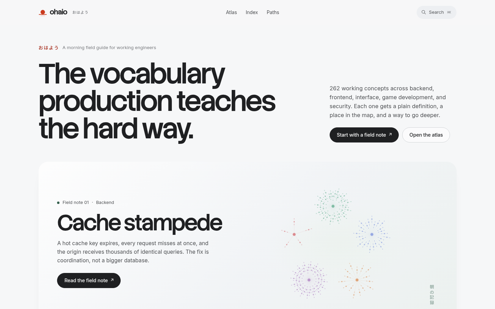
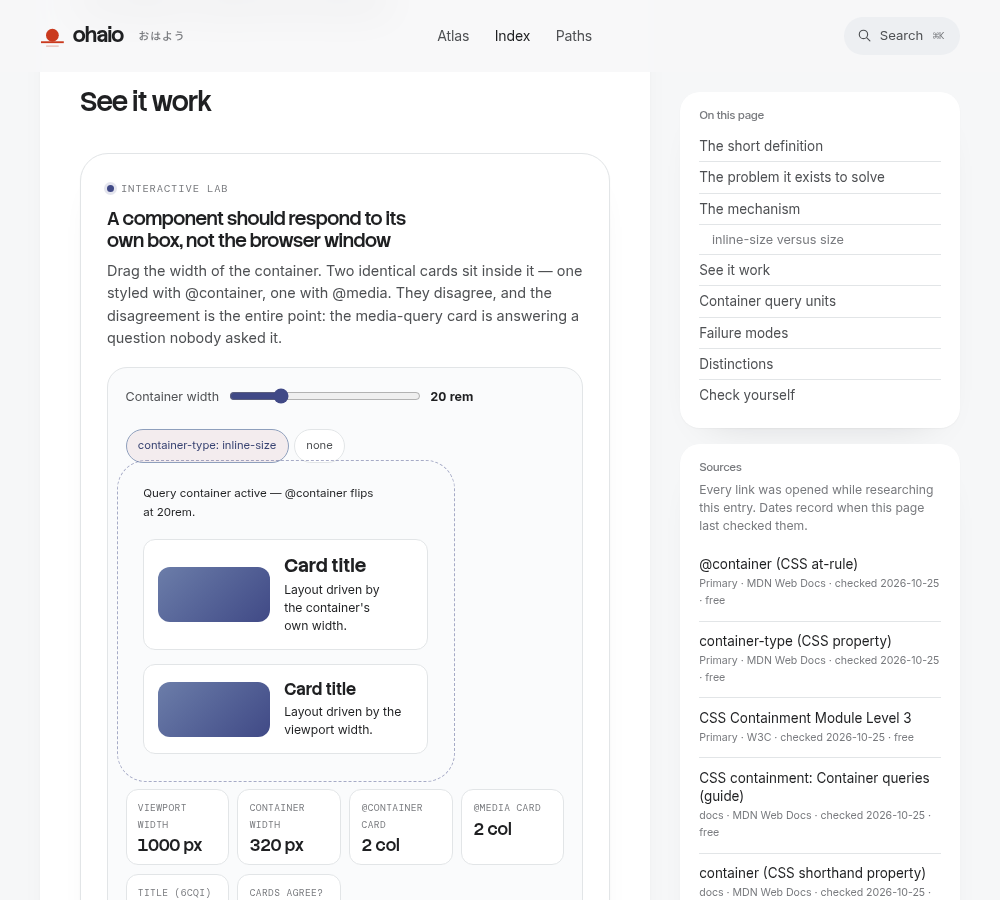
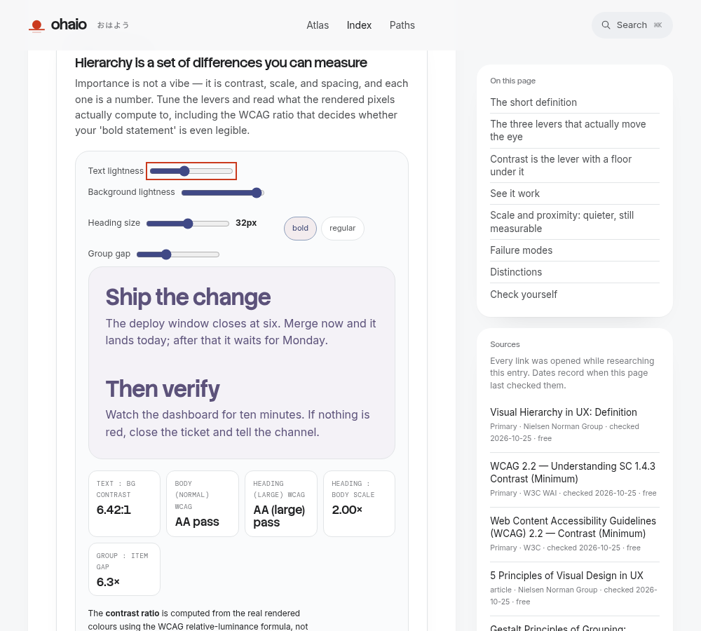
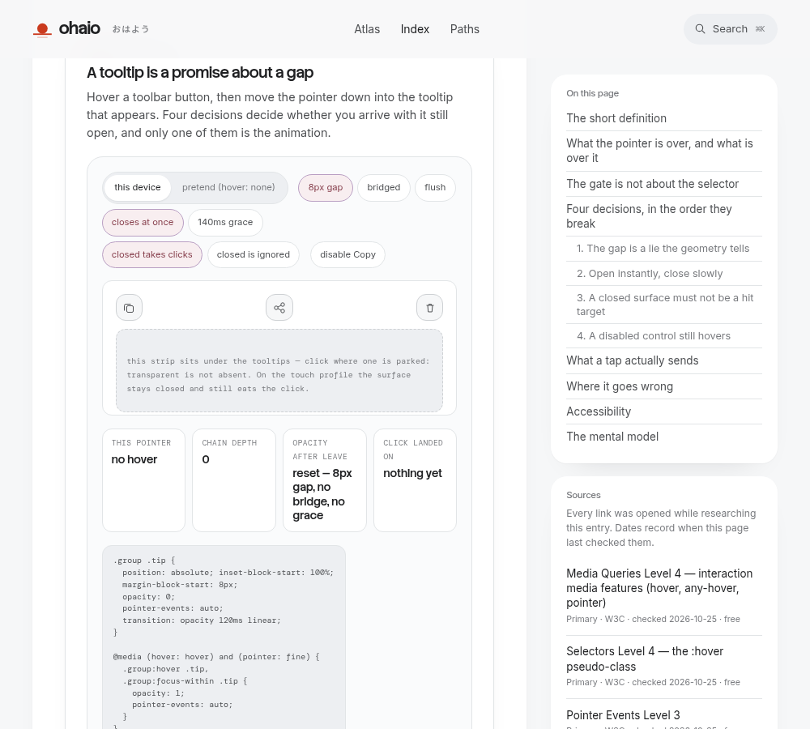
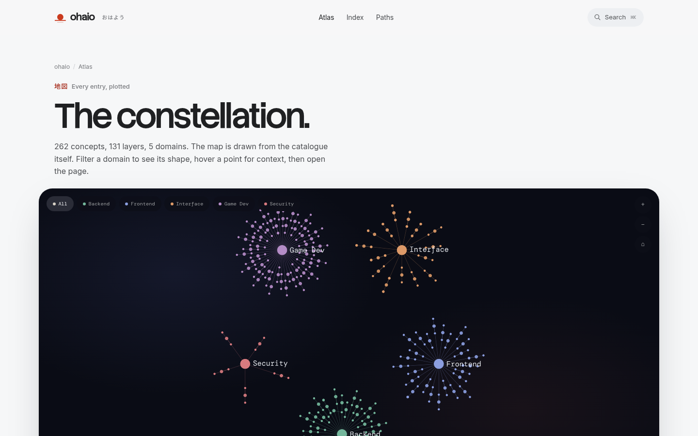
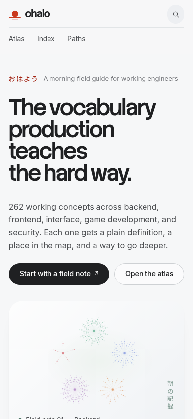

# ohaio · おはよう

**A morning field guide for working engineers.**

262 plain-language field notes on the concepts production actually teaches you the
hard way — backend, frontend, interface, game dev, security — each with a place on
the map and, where the idea is motion or layout, a lab you can break.



## Why it exists

Most references explain what a thing *is*. Fewer explain why it *hurts*. ohaio is
written for the engineer who has been paged at the wrong hour and wants the mental
model, not the definition. Every note follows the same spine:

- **The short definition** — one paragraph, no hedging.
- **The problem it exists to solve** — the failure that motivated it.
- **The mechanism** — how it actually works, down to the property or the syscall.
- **See it work** — an interactive lab where the concept is spatial or temporal.
- **Failure modes** — the ways it breaks in production.
- **Check yourself** — questions you can answer without looking.

## The labs

The concept is the thing you can drag. Each lab measures the *real* rendered result
in the browser and shows you the number, so a claim about contrast, timing, or layout
is a measurement, not an assertion.

Drag a container's width and watch a `@container` card flip while a `@media` card
answers a question nobody asked:



Tune text lightness, size, and spacing and read back the WCAG relative-luminance
ratio the rendered pixels actually compute:



Hover a toolbar button and move the pointer into the tooltip to find out, in order,
which of four decisions drops it:



## The atlas

Every note sits on a constellation — a force-directed graph of the domains and how
their concepts connect, so you can see what you have not read yet.



It works on the phone you are already holding, and it respects
`prefers-reduced-motion` throughout:



## How it is built

- **[Astro](https://astro.build/) 7** for the static shell, with **[React](https://react.dev/) 19**
  islands only where a page is interactive.
- **MDX** content collections, validated with **Zod** at build time.
- **[Tailwind CSS](https://tailwindcss.com/) v4** plus a hand-written token layer.
- **[sigma](https://www.npmjs.com/package/sigma) + [graphology](https://www.npmjs.com/package/graphology)**
  for the atlas graph; **[Motion](https://motion.dev/)** and native CSS view transitions
  for the labs.
- **[Pagefind](https://pagefind.app/)** for static, offline search.

## Content rules

Every note is written to a standard, and a build-time "doctor" enforces the parts
that can be checked mechanically:

1. Every reference link was opened while researching the note and returns **HTTP 200**;
   at least one is marked `role: primary`.
2. Every published note carries a `reviewed` date (YYYY-MM-DD) recording when the links
   were last checked.
3. Every measurement claim is backed by an actual measurement taken in the browser —
   if a lab can reproduce it, the lab says so.
4. Anything that moves respects `prefers-reduced-motion`.

The doctor fails the build if a published note is missing a primary source or a
reviewed date, or if a source URL is not absolute http(s). Link liveness itself is a
research discipline, verified by hand as each note is written.

## Run it locally

```bash
npm install
npm run dev        # content build + astro dev server
```

| Command | What it does |
| --- | --- |
| `npm run dev` | Build the data, then start the dev server. |
| `npm run build` | Build the data, run the content doctor, produce the static site in `dist/`. |
| `npm run preview` | Serve the production build. |
| `npm run check` | Type-check with `astro check`. |
| `npm run content:doctor` | Validate links, dates, and schema across every note. |
| `npm run content:scaffold` | Generate a new field-note skeleton from the taxonomy. |

## License

Source and content are made available for learning and reference. If you intend to
redistribute or build on it, open an issue first.
