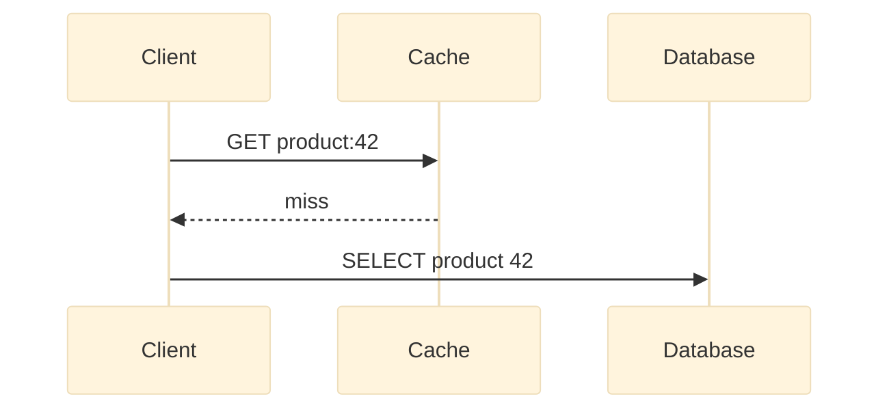

# Ohaio content and platform refactor plan

**Status:** proposal for review
**Date:** 2026-10-24
**Scope:** content model, authoring pipeline, diagrams and interactives, search, indexing, quality gates, migration, and content production
**Out of scope:** visual redesign of the existing interface; replacing Astro; building a database-backed CMS

---

## 1. Executive summary

Ohaio's interface is finished. Its content is not.

The repository currently contains **268 catalogue entries**. **257 are generated placeholders** of roughly 120 words each, built from a single template. The other **11 are cleaned ChatGPT lessons** with broken citation fragments, duplicated headings, and instructions for an interactive lab whose embed was stripped. Only **12 unique external links** exist across those 11 pages. Nothing else has a source.

The most serious problem is not word count. It is provenance and durability:

- The ChatGPT share was supposed to supply **titles**, not explanations. The 11 published lessons violate that rule.
- `scripts/build_seed.py` rewrites **every** file under `src/content/concepts` on every run. Any researched content added today is destroyed by the next `npm run seed`.
- There is no way to distinguish researched content from generated filler, no review metadata, and no publication gate.
- Every one of the 268 pages can be indexed while 257 of them are thin, near-duplicate pages. That is exactly the pattern Google's **scaled content abuse** policy targets, even when the content is not AI-generated.

This refactor is therefore **not "write 268 articles."** It is:

1. **Separate taxonomy from content.** A curated taxonomy owns identity, placement, and relations. Authored MDX owns prose, sources, status, and review. Generation creates only missing scaffolds and never overwrites.
2. **Define and enforce a content standard.** Sources, examples, one visual, trade-offs, failure modes, recall questions, review dates.
3. **Publish in verified batches.** Unfinished pages stay visible as catalogue entries but are `noindex`, excluded from the sitemap, and absent from full-text search.
4. **Use the lightest visual tool that teaches the idea.** Mermaid diagrams rendered to SVG at build time for most concepts, React Flow only for genuinely interactive graph-shaped ideas, Markdown tables for trade-offs, Shiki for code, lite YouTube facades for video.
5. **Add the missing quality gates.** Schema validation, a content doctor, link checking, prose linting, accessibility and performance checks, and search/sitemap tests.

The realistic end state is a **60-100 entry field guide with full researched notes**, a **120-entry standard reference**, and an **honest glossary for the rest** — not 268 long essays. Every indexed page is source-backed, visually explained, and human-reviewed.

---

## 2. Audit: what is actually in the repository

### 2.1 Current numbers

| Metric | Current state | Consequence |
|---|---:|---|
| Catalogue entries | 268 | Large surface area, mostly unwritten |
| Published entries | 11 | All derived from ChatGPT lessons |
| Placeholder entries | 257 | ~120 words of generic filler each |
| Total body words | 48,705 | ~30,800 of those are placeholder text |
| Published word counts | 1,603–3,175 | Long, uneven, essay-shaped — not reference-shaped |
| Unique external source URLs | 12 (14 total) | Only 11 entries have any source at all |
| Layers | 131 | 126 layers contain exactly two concepts; the taxonomy mirrors a transcript outline |
| Diagrams | 0 | No visual explanation system |
| Inline citations | 0 | Claims are not traceable |
| Review metadata | 0 | No reviewer, date, or technical sign-off |
| `noindex` usage | 404 page only | All 257 stubs are indexable |
| Sitemap filtering | None | Sitemap contains unfinished pages |
| Search scope | Titles + summaries | Body content is not searchable |
| Content generation | Destructive | `npm run seed` overwrites all 268 files |
| Near-duplicate / colliding titles | 20+ | Duplicate work and ambiguous URLs |

### 2.2 Failure examples found in the current content

**Generic placeholder (257 files).** Every stub follows this shape:

> **Partial failure** is a catalogue entry in the **Production failure / overload** layer of backend engineering.
>
> The interesting failures usually live at the boundary between this concept and the rest of the system: under load, during partial failure, or when state drifts from the happy path.

This is true of almost any backend concept. It teaches nothing, and 257 near-identical variants create a thin-content risk.

**Malformed ChatGPT citation remnants.** In `src/content/concepts/backpressure.md`:

> The  Streams","asynchronous streaming specification"] specification formalizes this idea…

In `src/content/concepts/cache-stampede.md`:

> Suppose your application uses  data store"] to cache product details.

The PUA citation markers were stripped by `clean_lesson`, but the fragments survived.

**A lab that does not exist.** `circuit-breaker.md` contains a section titled "Try the interactive experiment" and a "Circuit Breaker Lab" with experiment instructions. The sandbox link was removed during cleanup, so the page instructs readers to use a simulator that is no longer there.

**Structural drift in published notes.** The same file contains duplicated nested headings ("Understand the problem" followed by "1. What is a circuit breaker?"), numbered headings alongside unnumbered ones, and an emoji in a heading. The 11 notes read like cleaned chat output, not edited reference pages.

**Taxonomy is a transcript outline, not a curriculum.** There are 131 layers for 268 concepts, and **126 of those layers contain exactly two concepts**. The structure preserves the shape of the original chat (two terms per section) rather than grouping concepts by how they are learned or used. Examples:

- Duplicate concepts: `Saga` / `Saga pattern`; `Draw call` / `Draw calls`; `NavMesh` / `Navigation mesh`; `LOD` / `Level of Detail`; `Canary deployment` / `Canary release`; `Optimistic update` / `Optimistic mutation`.
- Parent/child treated as peers: `Idempotency` / `Idempotency key`; `Popover` / `Anchored popover`; `Hydration` / `Hydration-only bug`; `XSS` / `DOM XSS`.
- Ambiguous titles: `CSR` vs `CSRF`; `SSRF` vs `CSRF`; `Component` (ECS) vs `Server Component`; `Level` vs `Level of Detail`; `POI` vs `Point light`; `Map` vs `Input mapping`; `Batching` (rendering) vs `Continuous batching` (inference).
- Tools and platforms mixed into concepts: `strace`, `ltrace`, `Hack The Box`, `TryHackMe`, `HackerOne`, `PortSwigger Web Security Academy`, `IndexedDB`, `localStorage`, `Service Worker`, `shadcn/ui`, `Radix`, `Three.js`, `WebGPU`.

### 2.3 Root causes

1. **The ChatGPT transcript was treated as a content source.** It should have been a title inventory only.
2. **A generator owns the content directory.** Generation and authorship are not separated.
3. **Scale was expanded before the editorial system existed.** 268 titles were scaffolded before a single researched page had a standard.
4. **There is no definition of "done."** A page can be marked `published` without sources, a visual, or review.
5. **There are no gates.** Builds pass with placeholders, broken citation remnants, dead labs, duplicate taxonomy, and unfinished pages in the sitemap.

---

## 3. Goals and non-goals

### Goals

- Every **published** page is accurate, source-backed, visually explained, and useful to a working engineer.
- Every page that does not meet that bar is **clearly unfinished** and is excluded from search engines and site search.
- Research is **durable**: re-running tooling never destroys authored work.
- Content production is **repeatable**: one workflow, one template, one checklist, one review gate.
- Static performance, accessibility, and the existing design quality are preserved.
- The 268 concept titles remain the inventory; no title is silently discarded.

### Non-goals

- Publishing all 268 entries as long-form articles.
- Building a database, headless CMS, or user accounts.
- Replacing Astro with a client-rendered framework.
- An academic footnote system with claim-level citations on every sentence.
- Putting an interactive canvas on every page.
- Chasing rich results by publishing thin pages faster.

---

## 4. Target architecture

### 4.1 Principles

1. **One source of truth per concern.** Taxonomy owns identity and placement; MDX owns editorial content and provenance.
2. **Generation is additive.** Scaffolding creates missing files and refuses to touch existing ones.
3. **No drift.** The build fails when taxonomy and content disagree.
4. **Publication is a gate, not a label.** `published` has enforceable minimums.
5. **Static first.** Diagrams and examples render at build time; client JavaScript is reserved for interaction that teaches something.
6. **Every claim has a path back to a primary source.**
7. **Unfinished content is visible but not indexed.**

### 4.2 Source-of-truth split

**Taxonomy — `src/data/taxonomy.json`**

Owns:

- slug, canonical title, aliases
- type (`concept`, `pattern`, `mechanism`, `failure-mode`, `tool`, `practice`)
- domain, layer
- difficulty, priority
- prerequisites, related, contrasts
- redirects for merged entries

**Content — `src/content/concepts/<slug>.mdx`**

Owns:

- summary (the 30-second definition)
- status, format, updated date, review record
- sources
- prose, diagrams, examples, tables

**Derived at build time**

- cards, palette entries, atlas nodes and edges
- published manifest for sitemap and tests
- learning-path ordering
- related lists and prerequisite hints

A build-time `src/lib/catalogue.ts` joins the two and throws on:

- a taxonomy entry with no content file
- a content file with no taxonomy entry
- a slug mismatch
- a published entry with missing requirements

This removes the current duplication where title/domain/layer are copied into frontmatter and can drift.

### 4.3 Target directory layout

```text
src/
  content.config.ts              # imports the pure schema
  content/
    schema.ts                    # Zod schemas, no Astro imports
    concepts/
      circuit-breaker.mdx
      cache-stampede.mdx
      ...
  data/
    taxonomy.json                # canonical identity, layers, relations
    paths.json                   # curated learning paths
    published.json               # generated manifest, do not edit
  lib/
    catalogue.ts                 # taxonomy + content join, typed
    sources.ts                   # source role labels, URL helpers
  components/
    mdx/
      Figure.astro
      Diagram.astro              # optional wrapper; Mermaid config
      Callout.astro
      Tradeoffs.astro            # optional; Markdown tables preferred
      CheckYourself.astro
      Sources.astro              # renders frontmatter sources by role
      CodeExample.astro          # optional wrapper around Shiki output
    flow/
      CircuitBreakerLab.tsx      # React Flow island
      ...
  pages/
    concepts/[slug].astro
    ...
scripts/
  scaffold-content.ts            # create missing files only
  content-doctor.ts              # schema, placeholders, requirements
  build-published-manifest.ts
  migrate-content.ts             # one-off .md -> .mdx + taxonomy
docs/
  refactor-plan.md
  content-standard.md            # extracted from this plan after approval
  archive/
    chatgpt-lessons/             # archived, never shipped
```

**Format choice:** use `.mdx` for all entries. Every entry will eventually need `<Figure>`, `<Callout>`, `<CheckYourself>`, or `<Sources>`. Keeping one extension avoids two pipelines. The cost is stricter MDX parsing; the content doctor catches unescaped braces and stray `<` characters.

### 4.4 Pipeline

```text
taxonomy.json ──┐
                ├──> content-doctor ──> Astro build ──> Pagefind ──> link check ──> deploy
concepts/*.mdx ─┘         │                 │
                          │                 ├──> sitemap (published only)
                          │                 └──> noindex (everything else)
                          └──> fails on drift, placeholders, missing sources
```

Order in CI:

1. `npm run check` — TypeScript + Astro diagnostics
2. `npm run content:doctor` — schema, taxonomy, placeholders, publication minimums
3. `npm run build` — static build, diagrams rendered
4. `npm run search:index` — Pagefind over published pages only
5. `npm run links` — lychee on changed content (full site weekly)
6. `npm run prose` — Vale on changed MDX
7. Accessibility and performance smoke tests on a sample

### 4.5 Content lifecycle

```text
scaffold ──> draft ──> in-review ──> published ──> stale
   │            │           │            │
   └────────────┴───────────┴──> archived (noindex, kept for redirects)
```

| Status | Meaning | Indexed? | Sitemap? | Search? |
|---|---|---|---|---|
| `scaffold` | Generated placeholder, no research | No | No | No |
| `draft` | Being researched/written | No | No | No |
| `in-review` | Awaiting technical/editorial review | No | No | No |
| `published` | Meets the standard | Yes | Yes | Yes |
| `stale` | Published but review is overdue | Yes, with a banner | Yes | Yes |
| `archived` | Merged or retired; redirect in place | No | No | No |

`archived` is preferable to deleting a URL. Merged concepts get aliases and redirects.

---

## 5. Content model and standard

### 5.1 Frontmatter template

```yaml
---
summary: "When a hot cache key expires, many requests miss at once and hit the origin together."
status: published
format: field-note            # field-note | glossary | standard
updated: 2026-10-24

reviewed:
  at: 2026-10-24
  by: "Ohaio maintainers"
  technical: true
  editorial: true

sources:
  - id: instagram-thundering-herd
    title: "Thundering Herds & Promises"
    url: "https://instagram-engineering.com/thundering-herds-promises-82191c8af57d"
    kind: article              # docs | spec | paper | book | article | video | course | talk | repo | practice
    role: deep-dive            # start | reference | deep-dive | watch | practice
    author: "Instagram Engineering"
    published: "2012-04-30"
    accessed: 2026-10-24
    free: true
    primary: true              # first-party or original source
    archiveUrl: ""             # fill for critical links when a snapshot exists
    note: "The original request-coalescing write-up."

  - id: redis-cache-patterns
    title: "Caching patterns"
    url: "https://redis.io/docs/latest/develop/use/patterns/"
    kind: docs
    role: reference
    publisher: "Redis"
    accessed: 2026-10-24
    free: true
    primary: true

versionNotes: "Applies to cache-aside architectures; examples use Redis 7 syntax."
---
```

**Deliberately absent from frontmatter:** title, slug, domain, layer, difficulty, related concepts. Those come from taxonomy. This prevents the current duplication and drift.

### 5.2 Schema sketch

Put the schema in `src/content/schema.ts` so both Astro and Node scripts can import it.

```ts
import { z } from "zod";

export const SourceSchema = z.object({
  id: z.string().regex(/^[a-z0-9-]+$/),
  title: z.string().min(3),
  url: z.string().url(),
  kind: z.enum([
    "docs", "spec", "paper", "book", "article",
    "video", "course", "talk", "repo", "practice",
  ]),
  role: z.enum(["start", "reference", "deep-dive", "watch", "practice"]).default("reference"),
  author: z.string().optional(),
  publisher: z.string().optional(),
  published: z.string().optional(),
  accessed: z.coerce.date(),
  free: z.boolean().default(true),
  primary: z.boolean().default(false),
  archiveUrl: z.string().url().optional(),
  note: z.string().max(200).optional(),
});

export const ReviewSchema = z.object({
  at: z.coerce.date(),
  by: z.string().min(2),
  technical: z.boolean().default(false),
  editorial: z.boolean().default(false),
});

export const StatusSchema = z.enum([
  "scaffold", "draft", "in-review", "published", "stale", "archived",
]);

export const FormatSchema = z.enum(["field-note", "glossary", "standard"]);

export const ConceptSchema = z
  .object({
    summary: z.string().min(80).max(180),
    status: StatusSchema,
    format: FormatSchema,
    updated: z.coerce.date().optional(),
    reviewed: ReviewSchema.optional(),
    sources: z.array(SourceSchema).default([]),
    versionNotes: z.string().max(300).optional(),
  })
  .superRefine((data, ctx) => {
    if (data.status === "published" || data.status === "stale") {
      if (data.sources.length < 3) {
        ctx.addIssue({ code: "custom", message: "Published entries need at least 3 sources." });
      }
      if (!data.reviewed?.technical) {
        ctx.addIssue({ code: "custom", message: "Published entries need a technical review." });
      }
      if (data.format === "field-note" && data.sources.length < 4) {
        ctx.addIssue({ code: "custom", message: "Field notes need at least 4 sources." });
      }
      if (data.sources.filter((source) => source.primary).length < 2) {
        ctx.addIssue({ code: "custom", message: "Published entries need at least 2 primary sources." });
      }
    }
  });
```

Schema cannot check body length, visual presence, or placeholder phrases. Those belong in `content-doctor`.

### 5.3 Entry anatomy

| Section | Purpose | Field note | Standard | Glossary |
|---|---|---|---|---|
| Summary (frontmatter) | The 30-second definition | 90–160 chars | 90–160 chars | 80–140 chars |
| What it is | One paragraph, no history lesson | ✓ | ✓ | ✓ |
| Why it matters | Concrete failure, cost, or capability | ✓ | ✓ | One sentence |
| Mental model | Analogy or first-principles framing | ✓ | ✓ | Optional |
| Diagram | One primary visual | Required | Required | Optional |
| How it works | Mechanics, sequence, state | ✓ | Short | — |
| Worked example | Code, config, numbers, or scenario | Required | One small example | One-sentence example |
| Trade-offs | Table: benefits, costs, use when, avoid when | Required | Table or bullets | — |
| Failure modes | What breaks in production | Required | 2–3 bullets | — |
| Distinctions | How it differs from 2 related concepts | Required | Optional | — |
| Check yourself | 3 recall/prediction questions | ✓ | 2 | — |
| Sources | 4–6, at least 2 primary | Required | 3–4 | 2 |
| Review metadata | Reviewer, date, technical sign-off | Required | Required | Required |
| Target length | 900–1,400 words | 350–700 words | 150–300 words |

The existing 2,300–3,200-word notes should be **cut, not padded**. A reference page is not an essay. If a concept needs 3,000 words, it is probably two concepts.

### 5.4 Quality rubric

A page can be published only when all of these are true:

- [ ] The summary defines the concept without using the concept's own name as the explanation.
- [ ] At least one concrete example, with numbers, code, or a scenario.
- [ ] At least one original visual (diagram, table, or interactive) that carries information, not decoration.
- [ ] Trade-offs or failure modes are stated explicitly.
- [ ] Two adjacent concepts are distinguished in prose or a table.
- [ ] Every non-obvious claim is traceable to a listed source.
- [ ] At least two sources are primary (official docs, spec, source code, paper, or first-party engineering write-up).
- [ ] All links resolve; critical links have an archive URL where possible.
- [ ] The page is written in Ohaio's voice, not copied or lightly paraphrased.
- [ ] A human has reviewed the technical content and the editorial quality.
- [ ] Visuals have text alternatives; the page works without JavaScript.
- [ ] The page is within its format's word budget.

### 5.5 Source policy

**Source tiers**

| Tier | Examples | Use |
|---|---|---|
| 1 — Primary | Official docs, RFCs/specs, source code, papers, first-party engineering blogs | At least 2 per published entry |
| 2 — Practitioner | Recognized books, conference talks, maintained technical blogs | Allowed, never the only source for a contested claim |
| 3 — Tutorial | Courses, video walkthroughs, high-quality guides | Useful for "learn more"; mark paid/free |
| Reject | SEO listicles, unattributed reposts, AI summaries, dead pages with no archive, content farms | Do not cite |

**Rules**

- Link to the canonical URL, not a search result, redirect, or aggregator.
- Record `accessed` for every source.
- Record publication date when known; for version-sensitive topics, record the version.
- Prefer one excellent source over five mediocre ones.
- Never use a video as the only source for a technical claim. Videos are for explanation and intuition; docs/specs/source are for correctness.
- Mark paid sources clearly. A paid source may support an entry, but a free primary source must exist.
- Use `archiveUrl` for critical pages that are likely to move. Check the Wayback Machine before publishing.
- Do not copy substantial text. Quote at most a sentence or two with attribution and link.
- Do not rehost YouTube videos or download/re-upload course material. Embed via the official player or link out.

**Source roles in the UI**

Group the "Go deeper" panel by intent rather than by media type:

- **Start here** — the single best introduction.
- **Reference** — docs/spec to return to.
- **Deep dive** — paper, long article, book chapter.
- **Watch** — talk or video.
- **Practice** — lab, exercise, CTF, course.

### 5.6 Before/after: what "researched" means

**Before (current stub):**

> Cache stampede is a catalogue entry in the Caching layer of backend engineering. The interesting failures usually live at the boundary between this concept and the rest of the system.

**After (target shape, abbreviated):**

> **Cache stampede** happens when a popular cache key expires and many requests miss it at the same time. Instead of one request rebuilding the value, every request does, so the origin sees a burst exactly when it can least afford one.
>
> The fix is not "cache harder." It is to make the rebuild single-flight: one request computes the value while the others wait, serve stale data briefly, or refresh probabilistically before expiry.
>
> [Sequence diagram: 50 clients → cache miss → 50 origin queries → origin saturation]
>
> | Strategy | Cost | Use when |
> |---|---|---|
> | Request coalescing / single-flight | One slow request blocks peers | You can tolerate a short wait |
> | Stale-while-revalidate | Readers may see slightly old data | Freshness budget allows it |
> | Probabilistic early refresh | Extra background work | You can predict hot keys |
>
> Sources: Instagram Engineering's thundering-herd write-up; Redis caching patterns; your framework's single-flight docs.

The difference is not length. It is **specificity, a mechanism, a visual, a decision table, and traceable sources**.

---

## 6. Visual system

### 6.1 Decision matrix

| Teaching need | Tool | Client JS | When to use |
|---|---|---|---|
| Request/response flow, ordering, failure sequence | Mermaid `sequenceDiagram` | None (build-time SVG) | API calls, retries, sagas, cache misses, auth flows |
| State machine, lifecycle | Mermaid `stateDiagram-v2` | None | Circuit breaker, connection lifecycle, game states |
| Decision tree, trade-off path | Mermaid `flowchart` | None | "Which consistency model?", "Which rendering mode?" |
| Data model, schema | Mermaid `erDiagram` | None | Databases, domain models |
| Type/object relationships | Mermaid `classDiagram` | None | ECS, UI component trees, protocols |
| Comparison, trade-offs | Markdown table | None | The default for decisions |
| Code, config, commands | Shiki / Expressive Code | None | Every example |
| Metrics, latency curves, before/after | Hand-authored SVG or a small build-time chart | None | Performance entries |
| Interactive topology or simulation | React Flow (`@xyflow/react`) | Lazy island | Cache stampede, circuit breaker lab, retry storm, saga orchestration, backpressure |
| Video | Lite YouTube facade | On click | Talks, walkthroughs |
| Conceptual illustration | Original SVG or Excalidraw export | None | Only when a diagram cannot express it |

**Rule: one primary visual per entry.** A field note may have a diagram plus one table. It should not have three diagrams competing for attention.

### 6.2 Mermaid at build time

**Recommended:** render Mermaid fences to inline SVG during the build with `rehype-mermaid` (which uses `mermaid-isomorphic` and Playwright under the hood). This gives:

- diagrams in the initial HTML, visible without JavaScript
- searchable text and accessible `<title>`/`<desc>`
- no Mermaid runtime shipped to readers
- consistent output and caching

Implementation notes:

- Exclude `mermaid` from Shiki highlighting (`excludeLangs`). Astro 5.5 added this specifically so rehype plugins can take over Mermaid/D2 fences.
- Configure Mermaid with `theme: "base"` and theme variables mapped to Ohaio's colors (cream background, ink, domain accents). The site is currently light-only, so one theme is enough. If dark mode is added later, render two variants and toggle with CSS.
- Add `accTitle` and `accDescr` to every diagram:



- Wrap diagrams in a `<Figure>` with `caption` and render a `<figcaption>`. Keep the caption explanatory, not a restatement of the title.
- Add a CI step that installs Chromium for Playwright, or pin the browser used by `mermaid-isomorphic`. Build-time browser rendering is the main fragility of this approach.

**Fallback if CI cannot run a browser:** pre-render diagrams with `@mermaid-js/mermaid-cli` in a `prebuild` script and commit the resulting SVG files. This is more deterministic and faster, at the cost of an extra step when a diagram changes. Do not fall back to client-side rendering for content diagrams; it breaks no-JS readers and delays the visual until hydration.

### 6.3 React Flow rules

Use React Flow only when **manipulating the graph teaches something a static diagram cannot**: changing failure thresholds, watching a queue fill, rerouting a request, or stepping through a saga.

Rules:

- Use `@xyflow/react`, not the old `reactflow` package.
- Load with `client:visible` or a dynamic import. Never `client:load` on a content page.
- Keep all diagram data serializable and colocate it with the island.
- Render a static fallback (Mermaid diagram or SVG) inside the island before hydration, and a text alternative beside it.
- Support keyboard focus and controls; do not make drag the only way to interact.
- Respect `prefers-reduced-motion`; pause auto-running simulations.
- Add a "Reset" control and a short "what to try" instruction.
- Cap interactive demos at 8–12 pages initially. Measure the added JS; set a per-page budget after the first baseline.

Candidate concepts by demo value:

| Concept | Interaction | Why interaction helps |
|---|---|---|
| Circuit breaker | Change failure threshold, outage length, request rate | The state transitions are easier to feel than to read |
| Cache stampede | Toggle coalescing / stale-while-revalidate | Watch origin load collapse |
| Retry storm | Add jitter, backoff, retry budget | See synchronized retries vs spread |
| Backpressure | Adjust producer/consumer rates, queue size | See drop vs block vs buffer |
| Saga | Step through compensations | Understand partial failure recovery |
| Rate limiter | Change algorithm and burst size | Token bucket vs sliding window |
| Connection pool exhaustion | Vary pool size and query latency | See wait vs fail fast |

A static Mermaid diagram is better for: TCP handshake, OAuth flow, database isolation levels, render pipeline stages, and most protocol sequences. Interaction would be decoration.

### 6.4 Tables, code, images, video

**Tables** — use Markdown tables for trade-offs, comparisons, and failure matrices. Wrap them in a responsive scroll container; never use a table for layout. Tables are also excellent for "X vs Y" pages and reduce the need for prose.

**Code** — Shiki is already built in. Add Expressive Code only if its frames, titles, line highlighting, and copy affordance are worth the dependency. Code blocks should:

- be minimal and runnable or directly adaptable
- include a language and a title when the file context matters
- show expected output separately
- link to a StackBlitz/CodeSandbox for runnable frontend examples, rather than embedding a heavy sandbox
- avoid fake APIs; use real library names and versions where possible

**Images** — use Astro's `<Image>` with explicit dimensions, `loading="lazy"` below the fold, and descriptive alt text. Diagrams are not images in the editorial sense; they are figures with captions.

**Video** — use a lite YouTube facade (`lite-youtube-embed` or a small custom component), load the thumbnail through Astro's image pipeline, and only load the YouTube player on click. Use `youtube-nocookie.com`. Provide a text summary and a direct link. Never autoplay. Do not use video as the only explanation.

### 6.5 Accessibility and performance

- Mermaid SVG must have `accTitle`/`accDescr`; figures must have `<figcaption>`.
- Never encode meaning only in color. Use labels, patterns, or annotations.
- Interactive demos need keyboard controls, visible focus, a text alternative, and a pause/reset.
- Honor `prefers-reduced-motion`; no autoplaying simulations.
- Static article pages should ship **zero new client JS** for diagrams and examples. The palette and progress indicators remain the only shared islands.
- Lazy-load Pagefind and React Flow.
- Set and enforce a JS budget: measure baseline first, then target no increase for static concept pages and a declared budget for interactive pages.
- Test the build with JavaScript disabled. The article, diagram, table, sources, and navigation must still work.

---

## 7. Taxonomy curation

### 7.1 Classify every entry

The catalogue currently mixes several kinds of thing. Add a `type` field and present them differently:

| Type | Definition | Examples | Page treatment |
|---|---|---|---|
| `concept` | An idea or property | Idempotency, consistency, latency | Standard entry |
| `pattern` | A reusable solution shape | Circuit breaker, saga, outbox | Standard entry with trade-offs |
| `mechanism` | How a system works internally | TCP handshake, event loop, page table | Standard entry with sequence/state diagram |
| `failure-mode` | A way systems break | Retry storm, cache stampede, write skew | Field note with incident scenario |
| `tool` | A product or library | Redis, React Flow, Three.js | Shorter entry; link to docs; avoid version-chasing |
| `practice` | A way of working | Code review, threat modeling | Short entry; process, not code |
| `platform` | A learning/practice service | TryHackMe, PortSwigger Academy | Move to **Field kit**; not a concept page |

**Field kit.** Create `/field-kit` (or `/practice`) for platforms, tools, and learning services. It can be a curated directory with what it is, who it is for, cost, and a direct link. Redirect the old concept URLs. This preserves the titles without pretending a platform is a concept.

### 7.2 Merge, split, and disambiguate

These are confirmed or high-probability issues. Read both entries before merging; some are parent/child rather than duplicates.

| Current pair | Recommended action |
|---|---|
| `Saga` / `Saga pattern` | Merge into `saga-pattern`; alias `saga`. |
| `Canary deployment` / `Canary release` | Merge into `canary-deployment`; alias. |
| `Draw call` / `Draw calls` | Merge into `draw-calls`; alias. |
| `LOD` / `Level of Detail` | Merge into `level-of-detail`; alias `lod`. |
| `NavMesh` / `Navigation mesh` | Merge; keep one canonical spelling; alias. |
| `Optimistic update` / `Optimistic mutation` | Merge unless one is specifically client-state and the other server-state; if so, make one the parent and link the other. |
| `Hover` / `Hover feedback` | Merge into one hover entry with a feedback section; alias. |
| `OOM killer` / `OOMKilled` | Parent/child: kernel mechanism and Kubernetes symptom. One entry with both, or two linked entries. |
| `Idempotency` / `Idempotency key` | Keep parent/child; the key entry is the mechanism, the parent is the property. |
| `Popover` / `Anchored popover` | Parent/child; anchored popover is a technique. |
| `Hydration` / `Hydration-only bug` | Parent/child; the bug belongs as a failure section or a linked entry. |
| `XSS` / `DOM XSS` | Parent/child; keep both if DOM XSS has enough distinct material. |
| `Focus` / `Focus management` / `Focus trap` / `Focus restoration` | Consolidate into one `focus-management` field note with sections; or keep `focus-trap` and `focus-restoration` as linked details. |
| `CSR` / `CSRF` | Disambiguate immediately: "Client-side rendering (CSR)" vs "Cross-site request forgery (CSRF)". |
| `SSRF` / `CSRF` | Spell out one or both; they are distinct attacks. |
| `Component` (ECS) / `Server Component` / `Client Component` | Rename the ECS entry "ECS component"; keep the React entries paired. |
| `Level` / `Level of Detail` / `Level design` | Rename "Game level"; keep LOD and level design distinct. |
| `POI` / `Point light` | Rename "Points of interest"; avoid the abbreviation collision. |
| `Map` / `Input mapping` | Rename "Game map" or fold into level design. |
| `Batching` / `Continuous batching` | Disambiguate by domain: rendering batching vs LLM inference batching. |
| `Skeleton` / `Shimmer` | Keep both; shimmer is an animation technique applied to skeletons. Add a relation. |
| `Clock skew` / `Clock drift` / `Clock step` | Keep three; add distinctions: offset vs rate vs discontinuity. |
| `Save state` / `Checkpoint` / `Game state` | Keep if definitions differ; add a comparison table. |
| `strace` / `ltrace` | Distinct tools; move to Field kit or a "debugging tools" annex. |

For every merge: add an alias in taxonomy and a redirect. Do not break inbound links.

### 7.3 Consolidate layers

131 layers is not a curriculum. Target roughly **35 layers**:

**Backend (9):** failure and overload; concurrency and consistency; storage and indexing; caching; messaging and workflows; networking and protocols; architecture and boundaries; observability and operations; identity and security.

**Frontend (8):** browser platform and event loop; rendering and hydration; state and data flow; performance and loading; networking and caching; React and the component model; build and tooling; accessibility and resilience.

**UI (6):** motion and easing; components and overlays; interaction and input; feedback and loading; layout and typography; navigation and accessibility.

**Game development (8):** engine and game loop; rendering and graphics; assets and pipeline; physics and collision; gameplay systems and AI; multiplayer and netcode; web games and platform; performance and profiling.

**Security (4):** web vulnerabilities; offensive practice; defensive operations; binary, crypto, and reverse engineering.

Layer changes require updating the atlas graph, domain pages, and learning paths. Do it once, in a dedicated phase, with redirects for anchor links if old layer anchors are referenced.

### 7.4 Relations

Add explicit relations in taxonomy:

```json
{
  "slug": "cache-stampede",
  "prerequisites": ["caching", "cache-aside"],
  "related": ["cache-invalidation-race", "stale-while-revalidate"],
  "contrasts": ["cache-penetration"],
  "aliases": ["thundering herd"]
}
```

- **Prerequisites** drive "read this first" and learning paths.
- **Related** drives the aside and atlas edges.
- **Contrasts** drive "X vs Y" callouts and reduce confusion between near-neighbours.
- **Aliases** drive search synonyms, redirects, and disambiguation.

Do not auto-generate all edges from layer membership. A layer is a shelf; a relation is a claim about how ideas connect.

### 7.5 Priority tiers

| Tier | Count target | Criterion | Treatment |
|---|---:|---|---|
| P0 — flagship | 40–60 | Foundational, cross-domain, frequently searched, high failure cost | Full field note, diagram, example, 4–6 sources, review |
| P1 — core | 100–120 | Important within a domain or path | Standard entry, 3–4 sources |
| P2 — glossary | remaining | Useful vocabulary, narrow or advanced | 150–300 words, 2 sources, one example; indexable once it meets the glossary bar |
| Field kit | ~10–15 | Tools, platforms, services | Directory entry, not a concept |

Priority is editorial, not algorithmic. Start with the concepts a working engineer needs in their first two years, then the ones that explain production failures, then the long tail.

---

## 8. Research and editorial workflow

### 8.1 Per-entry workflow

| Step | Work | Output |
|---|---|---|
| 1. Scope | Read the taxonomy entry, prerequisites, contrasts; write the one-sentence definition | Definition |
| 2. Gather | Find 3–6 sources, prioritizing primary docs/specs/source/papers | Source list with roles |
| 3. Extract | Take claim-level notes: claim → source → exact location | Notes, not prose |
| 4. Outline | Apply the entry anatomy; choose the visual | Outline + visual plan |
| 5. Draft | Write from notes in Ohaio's voice; no pasted lesson text | Draft |
| 6. Build | Create the diagram/example; run the code; capture output | Verified artifact |
| 7. Fact-check | Re-read every non-obvious claim against a source; check every link | Corrected draft |
| 8. Edit | Cut filler; tighten; check reading level and accessibility | Edited draft |
| 9. Review | Technical sign-off + editorial sign-off; record reviewer/date | Approved entry |
| 10. Publish | Set status, generate manifest, build, index, check | Live page |

**Time per entry (editorial):**

- Field note: 3–5 hours
- Standard: 1.5–2.5 hours
- Glossary: 30–60 minutes
- Interactive demo: add 3–6 hours for design, build, accessibility, and testing

### 8.2 Batching

Work in **batches of 8–10 entries from one layer or learning path**, not randomly across domains. Benefits:

- shared sources and vocabulary
- consistent diagrams
- easier technical review
- visible progress on a coherent shelf
- fewer orphaned entries

Cadence: one batch every 1–2 weeks with a single editor/researcher. Do not start a new batch until the previous batch passes the doctor and review.

### 8.3 AI policy

Use AI as a **drafting and structuring aid**, never as a source.

Allowed:

- outline from human notes
- suggest analogies or examples for a human to verify
- generate a first-pass Mermaid skeleton
- check consistency, reading level, and terminology
- find candidate sources (every candidate must be opened and verified)

Not allowed:

- inventing links, quotes, benchmarks, or incidents
- citing an AI model or a chat transcript
- publishing without human technical review
- mass-producing pages to fill the catalogue
- paraphrasing the ChatGPT lessons into "new" content

Keep the original ChatGPT lessons in `docs/archive/chatgpt-lessons/` for provenance. They are not a source and must not be published. The public site can state, on an about or methodology page, that entries are researched from primary sources and reviewed by humans.

### 8.4 Definition of done

An entry is done when:

- it has the correct status and format
- it meets the word budget and the quality rubric
- it has the required sources and a technical review
- it has at least one original visual
- every link resolves
- it works without JavaScript
- it passes axe and keyboard checks
- it appears (or does not appear) in search and sitemap according to its status

---

## 9. Search and discovery

### 9.1 Current state

The command palette and `/search` search only `cards.json`: title, summary, domain, layer. Once entries have real body content, readers will search for phrases like "write skew vs lost update" or "why does my cache miss stampede", which are not in the summaries.

### 9.2 Recommendation: Pagefind

[Pagefind](https://pagefind.app/) indexes the built HTML and runs entirely in the browser. It needs no server, no API key, and no index service. For a static Astro site with 60–300 pages, it is the simplest correct choice.

Implementation:

- Add `data-pagefind-body` to the `<article>` only when `status === "published"`. Pagefind's docs state that when `data-pagefind-body` is present on any page, only pages containing it are indexed. This excludes stubs without a second mechanism.
- Add `data-pagefind-filter="domain:backend"` and `data-pagefind-filter="type:failure-mode"` to the article for faceted search.
- Add `data-pagefind-meta="title"` and a source/date meta field.
- Keep the shared header, palette, and aside outside the indexed body.
- Run `pagefind --site dist` after `astro build`. Use the `astro-pagefind` integration or a postbuild script; the postbuild script is easier to reason about and test.
- Lazy-load `/pagefind/pagefind.js` in the palette when the user opens it. Debounce queries by ~150ms. Render grouped results with highlighted excerpts.
- Keep the current card search as the instant first-paint/empty-state experience; switch to Pagefind when the query is longer than a word or when the user opens the full search page.
- Test a body-only phrase in CI: assert the Pagefind result includes the expected URL. Assert that a stub-only phrase returns nothing.

**Why not Orama?** Orama is excellent for structured or vector search, but it requires shipping a client index and more integration code. Pagefind already solves static full-text search, excerpts, filters, and zero infrastructure. Revisit Orama only if search needs semantic ranking or a much richer query language.

### 9.3 Discovery surfaces

- **Command palette** — fast jump to any published entry; show domain, layer, and status. Keep keyboard-first behavior.
- **`/search`** — full results with excerpts, domain/type filters, query in the URL (`?q=`), and an accessible live region for result counts.
- **Atlas** — keep the spatial map; make published entries visually distinct, but do not imply that every dot is a finished page. The preview already labels status.
- **Concept index** — keep the full inventory, but group by the consolidated layers and show format/status honestly.
- **Learning paths** — curated orders using prerequisites, not alphabetic or layer-order lists. `paths.json` should be hand-authored and validated against taxonomy.
- **Related concepts** — pull from taxonomy, with a short "how it differs" line where confusion is likely.

---

## 10. SEO and indexing

The goal is not to maximize indexed pages. It is to make the **finished** pages discoverable and keep the unfinished ones out of the index until they are worth reading.

### 10.1 Rules

- **Sitemap:** include only `published` and `stale` entries. Build `src/data/published.json` in a prebuild script, then filter the sitemap in `astro.config.mjs`. Do not rely on a hand-maintained list.
- **Robots:** `noindex, follow` on `scaffold`, `draft`, `in-review`, and `archived`. The existing `BaseLayout` already supports a `noindex` prop; start passing it from `[slug].astro`.
- **Canonical:** one canonical URL per entry; merged entries redirect.
- **Structured data:** emit `LearningResource` (and/or `TechArticle`) with `name`, `description`, `teaches`, `educationalLevel`, `learningResourceType`, `isAccessibleForFree`, `citation`, `dateModified`, `author`, and `publisher`. Use it for semantic clarity; do not expect a specific rich result. Google retired several structured data types in 2025, including Course Info, so treat markup as machine-readable context rather than a rich-result strategy.
- **Open Graph:** domain-colored default image first; per-entry generated images later if worth the build complexity.
- **Byline:** show "Reviewed by" and "Last reviewed" on published entries. This is a trust signal and forces review metadata to stay current.
- **Stale content:** if `reviewed.at` is older than 12 months, set status to `stale`, show a banner, and queue a re-review. Stale is still indexed; silently rotting is worse.

### 10.2 Scaled content and AI policy

Google's spam policy defines **scaled content abuse** as producing many pages primarily to manipulate rankings rather than help users. Its generative-AI guidance says AI content is not automatically penalized, but it must meet the same quality and helpfulness standards. The practical implications for Ohaio:

- Do not publish the 257 stubs. They are near-duplicate, generic, and unhelpful.
- Do not mass-generate pages from a template and call them content.
- Do not use the ChatGPT lessons as a source.
- Publish fewer, better pages; keep the rest noindexed.
- Make the research and review process visible (sources, review dates, methodology).
- Prefer original diagrams, examples, and synthesis over rewritten definitions.

The 11 existing published notes should be **unpublished or marked `in-review` immediately** and rewritten from primary sources. Leaving them published while the rest of the site is repaired undermines the standard the refactor is trying to establish.

---

## 11. Quality gates

### 11.1 Content doctor

`npm run content:doctor` is a TypeScript script using the shared schema and `gray-matter`. It must fail the build on:

**Structure and drift**

- taxonomy entry with no content file, or content file with no taxonomy entry
- duplicate slugs, duplicate aliases, or alias colliding with a canonical slug
- status/format values outside the enums
- `published` without `reviewed.at`, `reviewed.by`, and `technical: true`
- `published` with fewer than the required sources for its format
- source IDs duplicated within an entry
- source URLs duplicated within an entry
- missing `accessed` dates
- `archiveUrl` present but not a URL

**Editorial quality**

- summary outside 80–180 characters
- body under the format's minimum word count
- no visual: no Mermaid fence, MDX figure, table, or interactive marker
- no code/example marker for a field note
- placeholder phrases: "catalogue entry", "belongs to the .* layer", "the vocabulary tutorials skip", "interesting failures usually live"
- ChatGPT artifacts: private-use Unicode, `sandbox:`, "Concept of the Day", "Spaced repetition", "I want you to"
- body contains an H1 (the page owns the H1)
- more than 16 H2/H3 headings (TOC overflow)
- duplicate H2 text within an entry
- TODO/FIXME markers in a published entry

**Taxonomy quality**

- 1:1 title/alias uniqueness
- no more than one entry per merged canonical slug
- no orphan entries (no layer, no domain)
- layers below a minimum size (warn, not fail)
- relations point to existing slugs
- `contrasts` and `prerequisites` do not point to self

**Publication manifest**

- `published.json` matches the set of entries with status `published` or `stale`
- sitemap filter count matches
- each published entry has a Pagefind-indexable article body

### 11.2 Link checking

Use [lychee](https://lychee.cli.rs/) via `lycheeverse/lychee-action`:

- run on changed Markdown/MDX in pull requests
- run the full site weekly on a schedule
- cache results between runs
- exclude localhost and known login-only URLs; allowlist paywalled sources explicitly
- fail on broken links; open an issue automatically for scheduled failures
- for critical links, verify an archive snapshot and fill `archiveUrl`

### 11.3 Prose linting

Use [Vale](https://vale.sh/) with MDX support (Vale documents `.mdx` as a supported format). Keep the rule set small and useful:

- Ohaio terminology: consistent spellings (`cache stampede`, `Idempotency key`, `JavaScript`, `PostgreSQL`)
- banned filler: "in today's fast-paced world", "delve", "crucial", "it's important to note", "robust", "seamless", "leverage" (unless literal), "landscape", "game-changer"
- passive voice warnings in instructional sections
- heading sentence case
- no emoji in headings
- no "simply", "just", "obviously"
- max sentence length warning

Do not let prose lint become a style war. Rules should catch slop and inconsistency, not personal preference.

### 11.4 Accessibility and performance

- `@axe-core/playwright` on the home page, atlas, a published concept, a glossary entry, and a search page. Fail on critical/serious violations.
- Keyboard walkthrough: skip link, header, palette open/close, atlas pan/zoom, interactive demo controls, sources, pager.
- Reduced-motion run: no autoplay, no scroll-triggered article animation, hover/focus still work.
- JavaScript-disabled run: article, diagrams, tables, sources, navigation visible.
- Lighthouse CI on a representative published entry: target LCP < 2.5s, CLS < 0.1, INP < 200ms on mobile.
- JS budget: record baseline; prevent regressions on static concept pages; enforce a declared budget on interactive pages.
- Visual regression on the atlas and one concept page (optional, high value once content stabilizes).

### 11.5 CI order and failure policy

```text
check → content:doctor → build → search:index → links → prose → a11y/perf smoke
```

- A broken schema, missing source, duplicate taxonomy entry, or placeholder in a published page **fails the build**.
- A broken link in a published page **fails the PR**; scheduled full runs open an issue.
- Prose warnings do not fail until the baseline is clean; then they become errors.
- Accessibility critical/serious violations fail.
- Performance budgets fail only on regression beyond the declared threshold.

---

## 12. Migration plan

### Phase 0 — Stop the bleeding (0.5–1 engineering day)

**Why first:** every subsequent phase depends on not losing work.

- Initialize git and commit a baseline (the repository is currently not a git repo). This is the single most important reversible safety step.
- Stop running `npm run seed`. Rename it to `content:scaffold` only after the overwrite guard exists.
- Mark the 11 ChatGPT-derived entries `in-review` (or `draft`) and pass `noindex` for them. Add a visible "This note is being rewritten" banner if you want to keep them reachable.
- Remove or disable the phantom "Circuit Breaker Lab" instructions until a real demo exists.
- Record baseline metrics with the audit script (entry count, published count, source count, broken links, build time).
- Archive `scripts/source/lessons.json` and the current 11 bodies under `docs/archive/chatgpt-lessons/`. They remain for provenance, not publication.

**Exit criteria:** no command can overwrite authored content; unfinished entries are noindexed; baseline is committed.

### Phase 1 — Foundations (4–6 engineering days)

- Generate `src/data/taxonomy.json` from the current cards, then hand-curate the obvious duplicates and collisions.
- Create `src/content/schema.ts`; rewrite `content.config.ts` to import it.
- Migrate `.md` to `.mdx`; remove title/domain/layer/difficulty/slug from frontmatter; add status/format/sources/review.
- Implement `src/lib/catalogue.ts` to join taxonomy and content and throw on drift.
- Implement `scripts/scaffold-content.ts` (missing-only, `--check` mode) and `scripts/content-doctor.ts`.
- Implement `scripts/build-published-manifest.ts`.
- Build MDX components: `Figure`, `Callout`, `CheckYourself`, `Sources`, optional `Tradeoffs`.
- Add `noindex` to `[slug].astro` for non-published statuses; add the review byline and updated date.
- Filter the sitemap using `published.json`.
- Add a `content:doctor` test fixture that proves the checks fail on a placeholder and a missing source.

**Exit criteria:** build is green; doctor catches known bad fixtures; no content is generated over authored files; every page has a status.

### Phase 2 — Curation (3–4 engineering/editorial days)

- Classify all 268 entries by type.
- Merge the confirmed duplicates; add aliases and redirects.
- Disambiguate the acronym and homonym collisions.
- Consolidate 131 layers into ~35; update domain pages, atlas, and anchors.
- Add prerequisites, related, and contrasts for the P0/P1 set.
- Move tools/platforms/practice services to the Field kit.
- Write `paths.json` for 5–8 curated learning paths.
- Assign priority tiers.

**Exit criteria:** no duplicate canonical titles; all acronyms spelled out; every entry has a type, layer, and priority; the atlas still renders.

### Phase 3 — Pilot six entries (3–5 editorial days)

Write six exemplary entries, one per domain plus one interactive:

| Domain | Entry | Visual |
|---|---|---|
| Backend | Circuit breaker | State diagram + optional React Flow lab |
| Backend | Cache stampede | Sequence diagram + trade-off table |
| Frontend | Event loop (or rendering pipeline) | Sequence/timeline diagram |
| UI | Focus management | Interactive focus demo + table |
| Game dev | Draw calls / batching | Before/after visual + metrics table |
| Security | SSRF | Flow diagram + payload/mitigation table |

For each: full research workflow, 4–6 sources, one original visual, a worked example, trade-offs, failure modes, recall questions, technical review, link check, axe check.

**Exit criteria:** the template and tooling survive contact with real content; time per entry is measured; the six pages meet every quality gate; the standard is adjusted before scaling.

### Phase 4 — Search, SEO, and CI (2–3 engineering days; can overlap Phase 3)

- Add Pagefind postbuild and the published-only index.
- Rewire the palette and `/search` to Pagefind with filters and excerpts.
- Add `LearningResource`/`TechArticle` JSON-LD.
- Add lychee, Vale, axe, and performance smoke checks to CI.
- Add tests for sitemap/noindex/search inclusion.
- Add a methodology/about page describing the research and review process.

**Exit criteria:** published pages are searchable by body text; stubs are absent from search, sitemap, and the index; CI enforces the gates.

### Phase 5 — Scale content (ongoing)

- P0: 40–60 field notes, batches of 8–10, one batch every 1–2 weeks.
- P1: 100–120 standard entries, same batching.
- P2: glossary entries, 30–60 minutes each.
- Re-review `stale` entries quarterly.
- Keep the doctor, link check, and axe checks green after every batch.

**Exit criteria:** every live, indexed entry meets its format's standard; no placeholders remain in published content.

### Phase 6 — Interactive visualizations (5–8 engineering days)

- Build 8–12 React Flow demos for the highest-value graph-shaped concepts.
- Add static fallbacks, keyboard controls, reduced-motion behavior, and reset controls.
- Measure the JS budget and performance on each interactive page.
- Link each demo from the corresponding field note; do not make the demo the only explanation.

**Exit criteria:** interactive pages pass axe and keyboard tests; static content remains JS-free; bundle budgets hold.

### Phase 7 — Maintenance (quarterly)

- Full link check and archive refresh.
- Stale review sweep.
- Search query review (what readers search for and do not find).
- Consolidate any new duplicates.
- Revisit the glossary threshold and promotion candidates.

---

## 13. Content production forecast

These are editorial estimates, not commitments. Review and verification are the bottleneck, not drafting.

| Tier | Entries | Depth | Sources | Visual | Editorial time each | Total |
|---|---:|---|---:|---|---:|---:|
| P0 field notes | 40–60 | 900–1,400 words | 4–6 | 1 diagram + 1 table | 3–5 h | 120–300 h |
| P1 standard | 100–120 | 350–700 words | 3–4 | 1 diagram or table | 1.5–2.5 h | 150–300 h |
| P2 glossary | 88–128 | 150–300 words | 2 | optional | 0.5–1 h | 44–128 h |
| Field kit | 10–15 | 100–200 words | 1–2 | — | 0.5 h | 5–8 h |
| **Total** | **268** | | | | | **~320–736 h** |

At 20 editorial hours per week, that is roughly **4–9 months** for the full catalogue, plus 15–25 engineering days for the platform work. A credible first release is P0 only: **40–60 entries in 6–10 weeks**, with the rest noindexed.

If the ambition is a complete, high-quality atlas, this is the honest cost. If the ambition is a complete-looking atlas quickly, publishing generated pages is the wrong trade: it creates the exact thin-content risk the project is trying to avoid.

---

## 14. Risks and mitigations

| Risk | Likelihood | Impact | Mitigation |
|---|---|---|---|
| Thin/duplicate pages hurt search quality | High if stubs stay indexed | High | `noindex` + sitemap/search exclusion until a page meets the glossary bar |
| AI-assisted drafts contain invented claims or links | Medium | High | Claim-to-source notes; human technical review; lychee; no AI-only sources |
| Research is destroyed by regeneration | Certain today | High | Additive scaffold; overwrite guard; git baseline |
| Link rot and disappearing videos | High over time | Medium | lychee, archive URLs, prefer docs/specs, link checks in CI |
| Mermaid build is slow or fragile in CI | Medium | Medium | Pin Chromium; cache; pre-render CLI fallback; test diagrams in CI |
| React Flow bundle and hydration cost | Medium | Medium | Cap at 8–12 pages; `client:visible`; static fallback; JS budgets |
| Taxonomy churn breaks atlas and anchors | Medium | Medium | One curation phase; aliases/redirects; snapshot tests for graph counts |
| Scope expands to 268 essays | High | High | Tiering; 60 field notes is success, not failure |
| Reviewer bottleneck | High | Medium | Batch reviews; checklists; promote glossary before field notes |
| Copyright or attribution problems | Low–Medium | High | Original prose, short quotes with attribution, link don't rehost, archive license notes |
| Dark-mode diagram mismatch | Low now | Low | Site is light-only; revisit if dark mode is added |

---

## 15. Decisions and alternatives

| Decision | Recommendation | Alternative | Why |
|---|---|---|---|
| Framework | Keep Astro 7 | Next.js/Remix | Static content, islands, excellent build-time rendering, already built |
| Content format | MDX for all entries | Markdown + injected components | Visuals and source components need MDX; one pipeline is simpler |
| Taxonomy ownership | `taxonomy.json` + content frontmatter for editorial fields | Duplicate taxonomy in every file | Removes drift; one place to curate |
| Generation | Additive scaffold | Current destructive seed | Protects research |
| Diagrams | Mermaid → SVG at build | Client-side Mermaid; D2 | No runtime JS, accessible, SEO-friendly, good MDX ecosystem; D2 is viable but adds a toolchain |
| Interactives | React Flow for 8–12 graph-shaped demos | React Flow everywhere; custom SVG everywhere | Interaction only where it teaches; controls bundle |
| Search | Pagefind | Orama, Algolia, custom | Zero infrastructure, static, full-text with filters |
| CMS | None initially (Git + MDX) | Keystatic, Decap, Sanity | Code review and versioning fit the workflow; add a CMS only for non-technical editors |
| Citations | Structured source list + inline links | Academic footnotes everywhere | Meets reader needs without editorial overhead; add claim-level footnotes if needed |
| Unfinished pages | Visible but noindexed | Hide entirely; publish as-is | Keeps the atlas useful without poisoning search |
| AI | Drafting/structuring aid with mandatory human verification | Full generation; no AI | Quality and policy risk |
| Video | Lite YouTube facade, click-to-load | Raw iframe | Privacy, performance, no autoplay |
| Status model | Workflow status + format | Single `published` flag | Distinguishes "done" from "long" and enables glossary entries |

---

## 16. Immediate next steps

1. **Initialize git and commit the baseline.** There is no version control safety net right now.
2. **Freeze destructive generation.** Rename `seed` to `content:scaffold`, add a missing-only guard, and stop writing existing files.
3. **Unpublish the 11 ChatGPT notes** (or mark them `in-review` with `noindex`) and remove the phantom lab instructions.
4. **Generate and freeze `taxonomy.json`.** Do the obvious merges and acronym disambiguations first; defer layer consolidation to Phase 2.
5. **Add the schema and the content doctor.** Prove the gates fail on the current stubs before writing new content.
6. **Write the six pilot entries.** Use them to validate the template, Mermaid rendering, sources, accessibility, and time estimates.
7. **Add Pagefind, sitemap filtering, and noindex.** Keep unfinished pages out of search and search engines.
8. **Add CI checks.** `check`, doctor, build, search index, links, prose, and an axe smoke test.
9. **Start the P0 batches.** Do not start P1 until the pilot and gates are stable.
10. **Review this plan with the measured pilot data** and adjust the budgets and tier counts.

---

## Appendix A — Taxonomy entry template

```json
{
  "slug": "cache-stampede",
  "title": "Cache stampede",
  "type": "failure-mode",
  "domain": "backend",
  "layer": "caching",
  "difficulty": 3,
  "priority": "P0",
  "aliases": ["thundering herd"],
  "prerequisites": ["caching", "cache-aside"],
  "related": ["cache-invalidation-race", "stale-while-revalidate"],
  "contrasts": ["cache-penetration"]
}
```

## Appendix B — Content doctor pseudo-rules

```text
for each taxonomy entry:
  contentFile = concepts/<slug>.mdx
  assert exists(contentFile)
  data = parseFrontmatter(contentFile)
  assert data.status in STATUSES
  assert data.format in FORMATS
  assert 80 <= len(data.summary) <= 180
  assert no duplicate source ids
  assert every source.accessed exists
  assert every source.url is a URL
  assert data.status != published or data.sources.length >= 3
  assert data.status != published or data.sources.count(primary) >= 2
  assert data.status != published or data.reviewed.technical
  assert data.status != published or bodyHasVisual(contentFile)
  assert data.status != published or bodyWordCount >= minWords(data.format)
  assert no placeholder phrases
  assert no ChatGPT artifacts
  assert no H1 in body
  assert no TODO/FIXME in published
  assert all taxonomy relations resolve
  assert all aliases unique
  assert no content file without taxonomy entry
```

## Appendix C — Suggested first 30 field notes

These are existing catalogue titles, chosen for cross-domain leverage and production-failure value. They are a starting point for Phase 5, not a final P0 list; confirm after taxonomy curation.

| Domain | Entries |
|---|---|
| Backend | Cache stampede, Retry storm, Circuit breaker, Backpressure, Write skew, Idempotency, Transactional outbox |
| Frontend | Hydration, Layout thrashing, Long task, Query cache, Code splitting, Focus management |
| Interface | Easing, Command palette, Popover, Container query, Skeleton |
| Game development | Game loop, Fixed timestep, AABB, NavMesh, Level of Detail, Draw calls, Object pooling |
| Security | SQL injection, XSS, CSRF, SSRF, Binary exploitation |

Why this slice:

- It covers all five domains and both failure-oriented and interface-oriented thinking.
- It includes concepts that explain other concepts (game loop, hydration, AABB, idempotency).
- It has several natural diagrams and two strong interactive candidates (circuit breaker, cache stampede).
- It deliberately excludes tool entries and practice platforms, which belong in the field kit.

## Appendix D — Research sources used for this plan

These informed the tooling and policy recommendations; they are not sources for individual concept entries.

- [Astro content collections](https://docs.astro.build/en/guides/content-collections/) — schema, loaders, build-time content.
- [Astro 5.5 release notes](https://astro.build/blog/astro-550/) — excluding Mermaid/D2 from syntax highlighting so rehype plugins can render them.
- [rehype-mermaid + Playwright in Astro](https://dteather.com/blogs/astro-uml-diagrams/) — build-time diagram rendering.
- [Mermaid in Astro](https://realfiction.net/posts/mermaid-in-astro/) — integration options and trade-offs.
- [React Flow SSR/SSG configuration](https://reactflow.dev/learn/advanced-use/ssr-ssg-configuration) — fixed dimensions and server rendering constraints.
- [Pagefind indexing configuration](https://pagefind.app/docs/indexing/) — `data-pagefind-body`, `data-pagefind-ignore`.
- [Pagefind filtering](https://pagefind.app/docs/filtering/) — `data-pagefind-filter`.
- [Google Search spam policies](https://developers.google.com/search/docs/essentials/spam-policies) — scaled content abuse.
- [Google guidance on generative AI content](https://developers.google.com/search/docs/fundamentals/using-gen-ai-content) — quality standards for AI-assisted content.
- [lychee documentation](https://lychee.cli.rs/overview/) and [lychee-action](https://github.com/lycheeverse/lychee-action) — link checking in CI.
- [Vale](https://vale.sh/) and [Vale MDX format docs](https://docs.vale.sh/formats/mdx) — prose linting.
- [Diátaxis](https://diataxis.fr/) — separating tutorials, how-to guides, reference, and explanation. Ohaio entries are reference/explanation hybrids; keep the distinction in mind when deciding what belongs in an entry versus a learning path.
- [Lite YouTube embed](https://github.com/paulirish/lite-youtube-embed) — click-to-load video facade (privacy and performance).
- [schema.org LearningResource](https://schema.org/LearningResource) — structured data for educational pages.
- [Wayback Machine guidance](https://help.archive.org/help/using-the-wayback-machine/) — archive URLs for link-rot resilience.
- [Astro syntax highlighting](https://docs.astro.build/en/guides/syntax-highlighting/) — Shiki/Prism.
- [Expressive Code](https://expressive-code.com/) — optional code block treatment.

---

**Next review:** after the six pilot entries and the first content-doctor baseline. Adjust the word budgets, source minimums, and tier counts based on measured time and quality, not on the current 48,705-word baseline.
