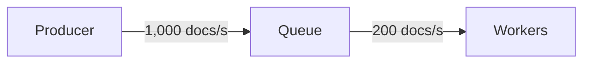
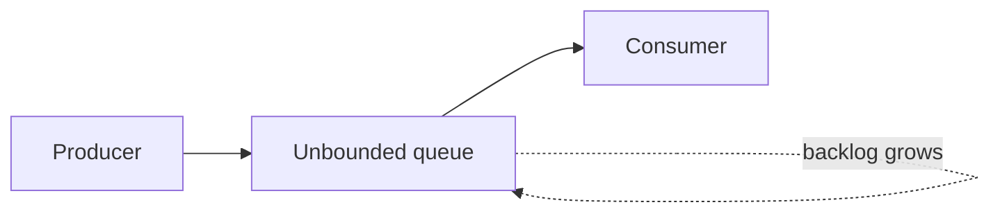
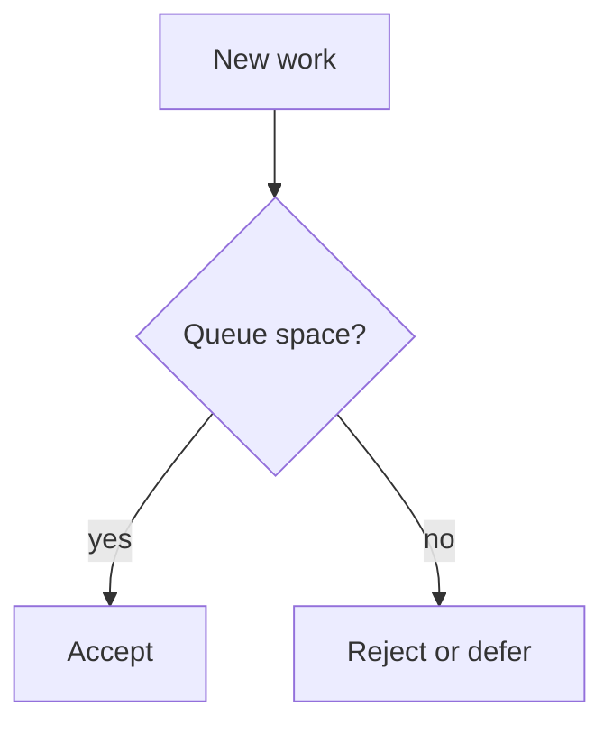
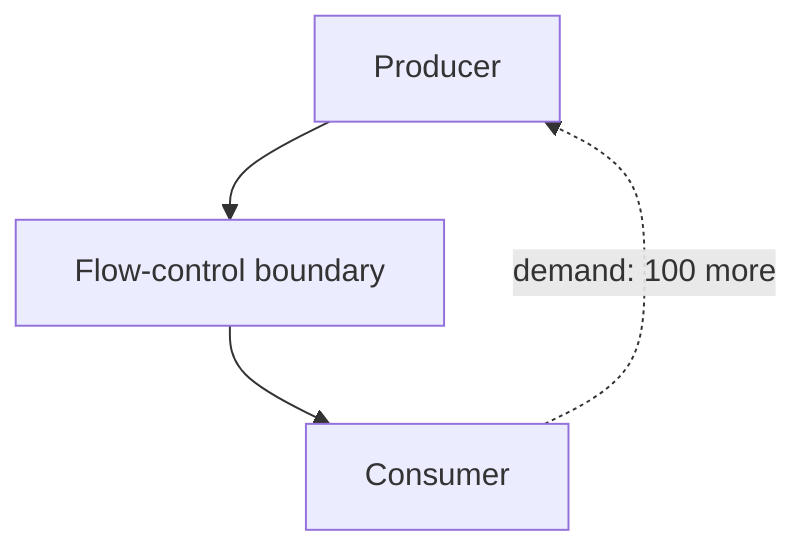
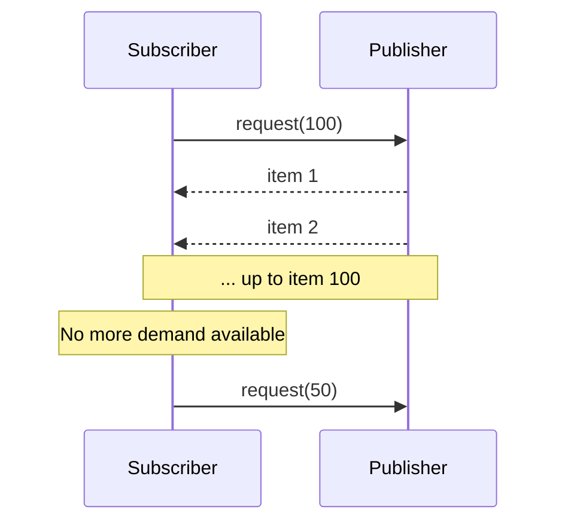
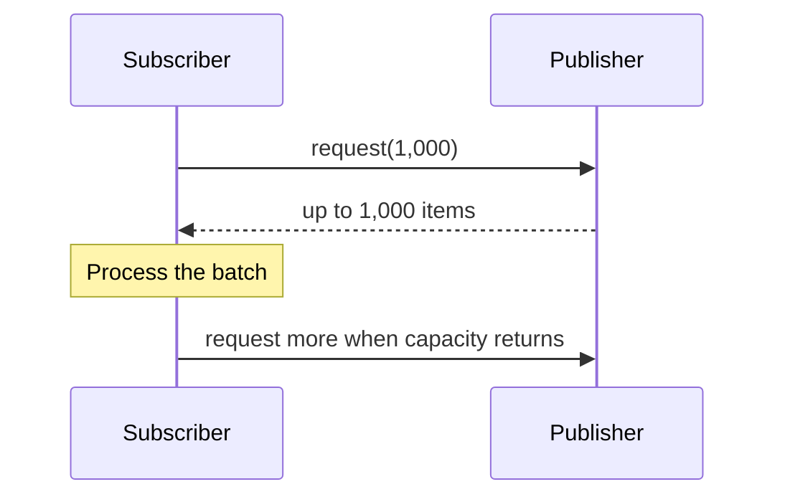
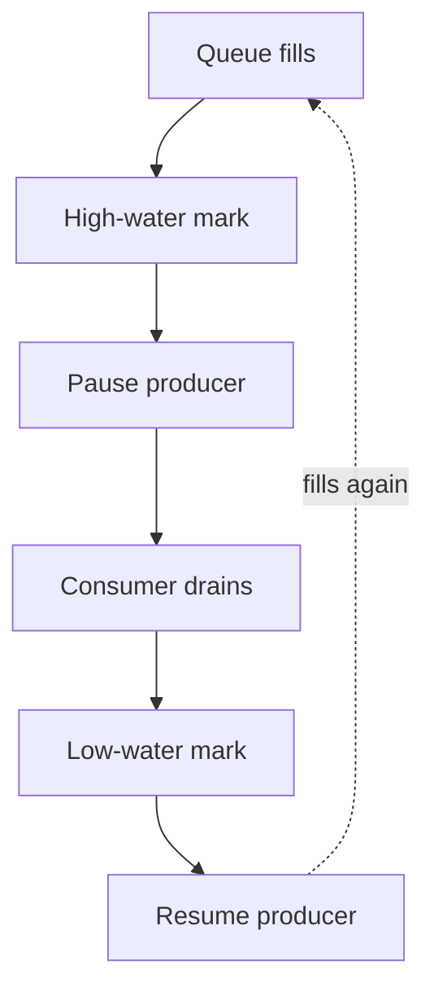
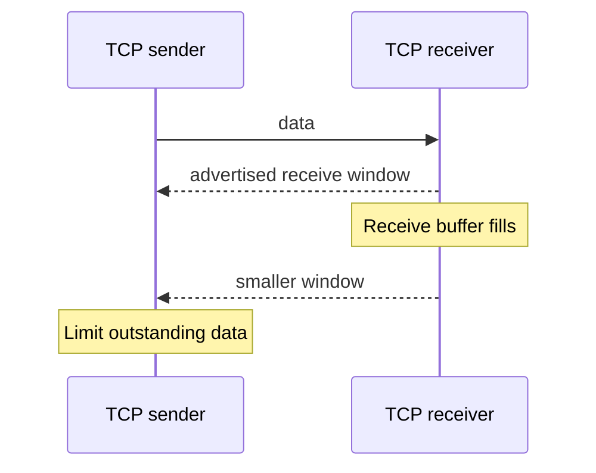
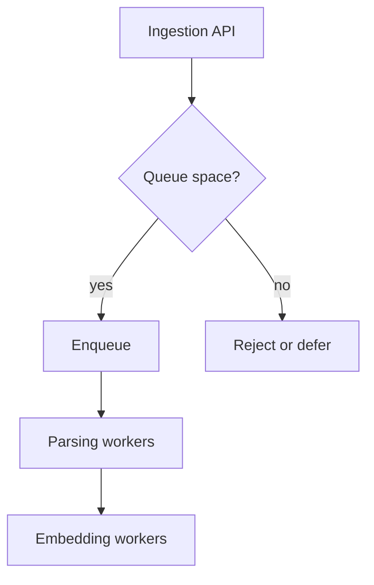
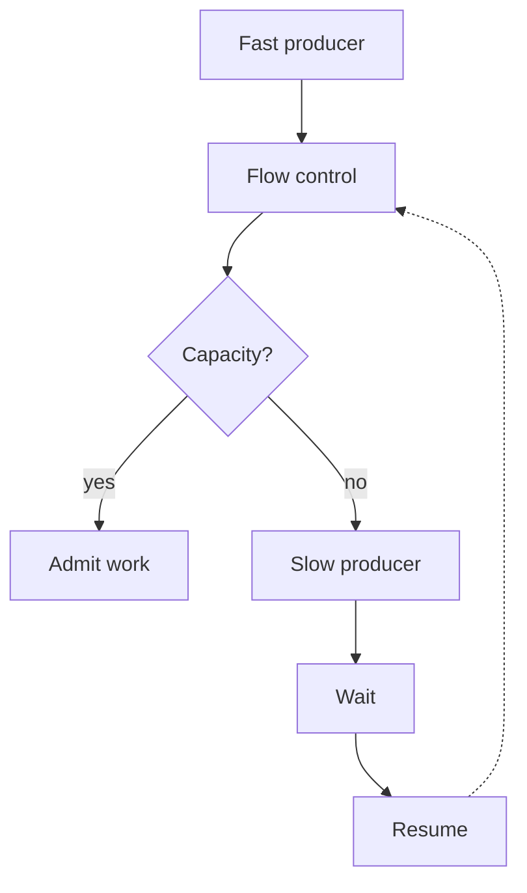

import BackpressureLab from "../../components/labs/BackpressureLab";

## Backpressure: How to Prevent a Fast Producer from Overwhelming a Slow Consumer

**Date:** October 16, 2026  
**Domain:** Distributed systems, networking, streaming architectures, production reliability.

Yesterday, we learned how the Bulkhead Pattern isolates resources so that one workload cannot starve others.

Today, we'll examine a related but different problem: **what happens when a system produces work faster than the next component can process it?**

This is particularly important when building:
- High-throughput APIs and event-processing pipelines.
- Kafka-based distributed systems.
- Data ingestion and ETL platforms.
- Real-time streaming applications.
- AI inference and document-processing pipelines.

The concept is called **backpressure**.

I've also built an interactive simulator so you can experiment with producer rates, consumer capacity, queue sizes, and different flow-control strategies.

---

## What is backpressure?
## 1. Start with a simple pipeline

Imagine a service that receives documents and converts them into embeddings using an AI model.

The architecture looks like this:

The producer creates 1,000 documents per second.

The workers process only 200 documents per second.

Every second, the system receives 800 more documents than it can process.

Where do those documents go?

They accumulate in the queue.

If the queue grows without a limit, the system eventually exhausts a resource, such as memory or disk space. If the queue has a fixed capacity, it eventually fills, and the system must decide what to do with additional work.

**Backpressure is a flow-control mechanism that allows a slower consumer to limit the rate at which a producer sends it work.**

Instead of blindly accepting everything, the system communicates or enforces how much work can safely proceed.

The central principle is:

> A producer should not continuously overwhelm a consumer that cannot keep up.

The [Reactive Streams](https://www.reactive-streams.org/) specification formalizes this idea for asynchronous stream processing: publishers must respect the demand expressed by their subscribers.

---

## What happens without backpressure?
## 2. The queue grows because arrival exceeds processing capacity

Let's define three variables:

- \(\lambda\): arrival rate, measured in items per second.
- \(\mu\): processing rate, measured in items per second.
- \(Q(t)\): number of queued items at time \(t\).

When arrivals exceed processing capacity, the queue grows approximately according to:

\[
Q(t+\Delta t)
=
\max(0,Q(t)+(\lambda-\mu)\Delta t)
\]

This simplified equation assumes constant arrival and processing rates, with no queue limit or dropped work.

Suppose:

\[
\lambda=1000 \text&#123; items/s&#125;
\]

\[
\mu=200 \text&#123; items/s&#125;
\]

Then:

\[
\lambda-\mu=800 \text&#123; items/s&#125;
\]

The queue grows by approximately 800 items every second.

| Time elapsed | Approximate queued items |
|---|---:|
| 1 second | 800 |
| 10 seconds | 8,000 |
| 1 minute | 48,000 |
| 10 minutes | 480,000 |

This assumes the arrival rate remains constant and the consumer processes 200 items per second continuously.

The problem becomes obvious when you look at memory.

Suppose each queued job consumes an average of 4 KB of memory.

After ten minutes:

\[
480000 \times 4\text&#123; KB&#125;
\approx 1.92\text&#123; GB&#125;
\]

That's approximately 1.92 GB using decimal units, excluding queue metadata, object overhead, and other application memory.

A queue that initially looked harmless can consume a substantial amount of RAM.

Eventually, the application may experience garbage-collection pressure, severe latency, or an out-of-memory failure.

## 3. Why does this happen from first principles?

A queue temporarily stores work that has arrived but has not yet been processed.

That is useful because producers and consumers rarely operate at exactly the same rate.

The queue absorbs short-lived differences.

For example:

| Component | Rate | Window |
| --- | --- | --- |
| Producer | 1,000 items/s | 5 seconds, so 5,000 items |
| Consumer | 200 items/s | continuous |

A queue can absorb that temporary burst.

But buffering does not create processing capacity.

If the producer consistently generates more work than the consumer can handle, the backlog continues growing.

<BackpressureLab client:visible />

This is the fundamental distinction:

**A queue absorbs temporary imbalance. Backpressure helps control sustained imbalance.**

---

## Why do we need backpressure?
## 4. Protecting latency, memory, and downstream services

Suppose your application accepts a request to process a PDF.

The request enters a queue, and a background worker processes it.

If 10,000 PDFs arrive simultaneously, the queue might grow dramatically.

Even if every PDF is eventually processed, users may wait several minutes for results.

Backpressure helps the system control how much work enters the pipeline.

Depending on the architecture, it can:

- Slow the producer.
- Delay production until capacity becomes available.
- Limit how much work is admitted.
- Propagate capacity information upstream.
- Trigger an explicit overload response when the producer cannot slow down.

This can preserve bounded resource usage and make latency more predictable.

However, backpressure does **not** make excess demand disappear. It changes how the system handles that demand.

If the producer cannot slow down, the application still needs a policy for excess work: buffer it within a limit, reject it, drop or sample it where acceptable, or scale processing capacity.

Spring's documentation on reactive programming explains this distinction and describes how demand can be propagated between asynchronous components. 

---

## Three approaches to handling overload
## 5. Approach A: Unbounded queue

The producer sends every item into a queue, regardless of the consumer's current capacity.

**Advantages:**
- Simple to implement.
- Temporarily absorbs bursts.
- Does not immediately reject work merely because the consumer is busy.

**Problems:**
- The queue may consume unbounded memory or disk.
- Queueing latency can become enormous.
- The system may fail before the backlog is processed.
- A restart may make recovery more difficult if the queued work isn't durable.

This is generally unsafe when the queue has no meaningful capacity limit and the workload can grow indefinitely.

## 6. Approach B: Bounded queue with rejection

Instead of accepting unlimited work, define a maximum queue size.

For example:

When the queue fills, the system refuses additional work.

For an HTTP API, that might mean returning a `429 Too Many Requests` or `503 Service Unavailable` response, depending on why the request cannot be accepted and the API's semantics.

For a background job system, it might mean pausing the producer, returning a retryable error, or routing the job to another durable queue.

**Advantages:**
- Bounds queue memory or storage consumption.
- Makes overload behavior explicit.
- Protects the consumer from unlimited accumulation.

**Trade-offs:**
- Some requests are rejected or delayed.
- Clients need a suitable retry strategy.
- If clients retry aggressively, rejection can trigger the retry storms we studied on October 13.

Bounded queues are often an essential part of a backpressure strategy, but a bounded queue by itself does not slow the producer.

## 7. Approach C: Backpressure

With backpressure, the consumer's capacity influences how much work the producer sends.

Instead of continuously creating work, the producer sends only the amount the consumer has indicated it can handle.

The exact mechanism depends on the system.

For example, a reactive stream may use an explicit demand protocol. A network service might pause reads when a buffer reaches a high-water mark. A job producer might wait for queue capacity before submitting more tasks.

The important property is that **capacity information influences production**.

---

## How backpressure works internally
## 8. Demand-based flow control

One formal implementation is used by Reactive Streams.

It has three important participants:

- **Publisher:** Produces items.
- **Subscriber:** Consumes items.
- **Subscription:** Mediates demand and cancellation.

The subscriber requests a certain number of items.

The publisher must not send more items than the subscriber has requested.

For example:

The subscriber can request more items when it has capacity to process them.

The publisher must respect the outstanding demand rather than continuously sending an unlimited stream of data. 

This is particularly useful for asynchronous processing pipelines where production and consumption happen independently.

### Why request batches instead of one item at a time?

Requesting one item at a time can introduce unnecessary coordination overhead.

If the publisher and subscriber communicate across a network, each demand update may add latency.

Instead, a subscriber can request a batch of items.

For example:

The batch size controls how much work can be in flight.

Large batches can improve throughput but increase buffering and the amount of work outstanding.

Small batches provide tighter control but may reduce throughput if coordination overhead becomes significant.

The correct batch size depends on the processing cost, latency requirements, and resource limits.

---

## 9. Watermarks: Another practical implementation

Not every producer supports a demand-based protocol.

Sometimes a system uses a queue with a high-water mark and a low-water mark.

For example:

| Threshold | Queue depth | Action |
| --- | ---: | --- |
| Capacity | 10,000 items | Hard limit |
| High-water mark | 8,000 items | Pause the producer |
| Low-water mark | 3,000 items | Resume the producer |

When the queue reaches 8,000 items, the producer is paused.

The consumer continues processing the backlog.

Once the queue falls to 3,000 items, the producer resumes.

Why use two thresholds instead of one?

Because a single threshold can cause rapid toggling.

Suppose the producer pauses at 8,000 and resumes immediately when the queue falls to 7,999.

If the producer quickly pushes the queue back to 8,000, the system repeatedly pauses and resumes.

Using a lower resume threshold provides **hysteresis**: the system must move far enough away from the high-water threshold before production resumes.

This reduces unnecessary state changes.

The thresholds are examples, not universal defaults. They should be chosen based on workload characteristics and measured queue behavior.

---

## How this connects to networking
## 10. TCP already has a form of flow control

Backpressure isn't limited to application queues.

The Transmission Control Protocol (TCP) has receiver-side flow control.

A TCP receiver advertises how much receive-buffer space it can accept through its advertised receive window.

If the receiving application doesn't read incoming data quickly enough, the receive buffer may fill. The advertised window can shrink, limiting how much additional data the sender can transmit without acknowledgment of further capacity.

Conceptually:

TCP flow control helps prevent a sender from overwhelming the receiver's advertised receive-buffer capacity.

However, TCP flow control is not the same as application-level backpressure.

A server might read data from its socket quickly and place it into an unbounded application queue. In that case, the network receiver can continue draining its TCP buffer while the application's work queue grows.

The pressure must reach the relevant processing boundary to protect that resource.

This is why application pipelines still need bounded queues, concurrency limits, and appropriate flow-control behavior even when they use TCP.

---

## When is backpressure actually needed?
Backpressure is particularly useful when production and consumption are asynchronous and their rates can differ significantly.

| Scenario | Why backpressure helps |
|---|---|
| Event-processing pipeline | Prevents consumers from being overwhelmed by producers |
| Database-to-API streaming | Limits the rate at which rows are fetched and serialized |
| PDF ingestion | Prevents ingestion from overwhelming parsing and embedding workers |
| AI inference | Controls the number of queued requests when inference capacity is limited |
| Network streaming | Controls how much data is sent into a slower downstream component |
| Background jobs | Prevents producers from creating more work than workers can process |

Consider an AI service.

Your document-ingestion system creates 5,000 embedding tasks per second, but your available GPU workers process only 1,000 tasks per second.

Without flow control, the backlog grows by approximately 4,000 tasks per second.

Backpressure can make ingestion wait when the inference queue reaches its capacity.

Alternatively, the API might accept work into a durable queue, but only within an explicitly defined storage budget.

If the queue is full, the system can reject new submissions or defer them.

The important design decision is whether the producer can be slowed and, if not, where excess work will be handled.

### When might you not need it?

A small batch-processing script that reads a finite file, processes it at a manageable rate, and has enough memory might not need a sophisticated backpressure protocol.

Similarly, a workload with naturally bounded input and known processing requirements may be adequately handled by a fixed-size queue.

The goal isn't to add complexity everywhere. It's to ensure that a faster component cannot create unlimited work for a slower component.

---

## Trade-offs and alternatives
Backpressure is not free, and it doesn't solve every overload problem.

| Approach | Benefit | Cost or limitation |
|---|---|---|
| Backpressure | Coordinates production with available processing capacity | Can propagate latency upstream |
| Bounded queue | Limits backlog and resource usage | Requires an overflow policy |
| Load shedding | Rejects work before the system collapses | Some requests deliberately fail |
| Sampling | Reduces the volume of nonessential data | Some events are discarded |
| Rate limiting | Caps request admission over a time interval | May reject traffic even when capacity is temporarily available |
| Horizontal scaling | Adds processing capacity | Costs more and may not scale instantly |
| Durable buffering | Absorbs bursts without requiring all work to remain in memory | Storage can fill, and processing latency can grow |

The mechanisms can be combined.

For example, a production ingestion API might use:

1. A bounded durable queue.
2. Backpressure when workers are approaching saturation.
3. Rate limiting for excessive clients.
4. Explicit rejection when the queue reaches its maximum capacity.
5. Controlled retries with backoff and jitter.

This creates multiple layers of protection.

But there is a fundamental limit: if the long-term arrival rate exceeds the maximum sustainable processing rate, no finite queue or backpressure mechanism can make every item complete immediately.

The system must eventually reduce demand, increase capacity, accept longer processing times, or reject some work.

---

## Production incident walkthrough
## 11. Incident: Document ingestion exhausts memory

Imagine you're building a production RAG platform that ingests PDFs and generates embeddings.

The system has:

- An HTTP ingestion API.
- A queue of pending documents.
- Parsing workers.
- Embedding workers.
- A vector database.

Under normal conditions, the platform receives 200 documents per second and processes 250 documents per second.

The queue remains small.

Then a customer uploads a large batch of documents.

Incoming work increases to 2,000 documents per second.

The workers still process only 250 documents per second.

### Minute 1: Backlog grows

The queue accumulates approximately:

\[
2000-250=1750
\]

additional documents per second.

After one minute:

\[
1750 \times 60=105000
\]

Approximately 105,000 additional documents are waiting, assuming those rates remain constant and no other bottleneck changes the processing rate.

### Minute 5: Resource pressure increases

The application stores document metadata and task objects in memory.

Memory consumption grows. Garbage collection becomes more frequent, and ingestion latency increases.

### Minute 8: The application crashes

The process runs out of memory.

After restarting, it begins receiving work again, and the backlog begins growing.

The service may enter a repeated failure-and-restart cycle.

### What would a better design do?

The ingestion API should not accept unlimited work into an in-memory queue.

Instead, it can use a bounded queue, pause upstream ingestion where possible, or return an explicit overload response.

The embedding stage can also apply backpressure to parsing if embeddings become the bottleneck.

For example, the parsing workers may stop pulling additional documents when the embedding queue reaches its high-water mark.

This prevents an upstream stage from generating an unlimited amount of work for a downstream stage.

If the system uses a durable queue, the same principle applies: durable storage can absorb bursts, but the queue still needs retention, capacity, and overload policies.

**The key is to apply flow control at the bottleneck, not merely at the entry point.**

---

## The mental model to retain

Remember these three distinctions:

- **Queues** absorb temporary differences between production and consumption.
- **Backpressure** controls production based on downstream capacity.
- **Load shedding** rejects or discards work when the system cannot safely accept it.

A reliable production system often needs all three.

---

## Active recall — today's questions

Try answering these without looking back at the lesson.

1. If a producer generates 1,500 jobs per second and a consumer processes 900 jobs per second, how quickly does the backlog grow, assuming no drops or other constraints?

2. Why can an unbounded queue eventually cause an application to fail even if the consumer continues processing jobs successfully?

3. How does a demand-based Reactive Streams protocol prevent a publisher from overwhelming a subscriber?

4. Why might a system use high-water and low-water marks instead of pausing and resuming production at one threshold?

5. If an external producer cannot be slowed down and the consumer is operating at maximum capacity, what options does the system have for handling excess work?

---
