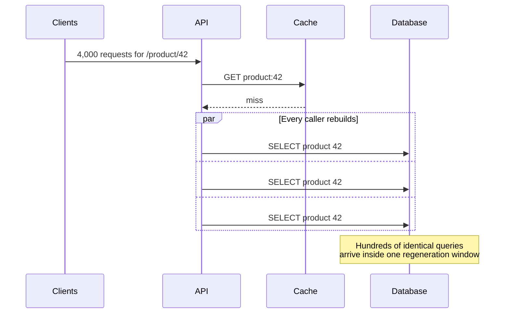

A cache is a coordination mechanism for **reuse**. It is not, by itself, a coordination mechanism for **regeneration**. That gap is the cache stampede.

The shape is always the same:

1. One key is hot — a product page, a feature flag, a pricing table.
2. The key expires, or is evicted under memory pressure.
3. Every request that arrives in the next few hundred milliseconds sees the same miss.
4. Each request independently runs the expensive query.
5. The origin receives a burst of identical work at the worst possible moment.

The result is also called a **thundering herd**, a **dogpile**, or **cache miss storm**. The names differ; the mechanism does not.

## The failure in one sequence



Under normal traffic the database sees one query per expiration. During the stampede it sees as many queries as there are concurrent callers.

The damage is not only database load. Each in-flight request holds a worker, a connection, and memory. As the origin slows, callers time out and retry. The retry storm then arrives while the first storm is still running.

## Why cache-aside does not save you

A typical cache-aside read looks like this:

```text
value = cache.get(key)
if value is missing:
    value = database.read(key)
    cache.set(key, value, ttl)
return value
```

That code is correct for a single caller. It has no notion of **other callers doing the same thing**.

If 1,000 requests run the `if` branch before any of them finishes `cache.set`, all 1,000 issue the query. The cache cannot turn them into one operation because no operation has completed yet.

The size of the burst is roughly:

```text
concurrent misses ≈ request rate × regeneration time
```

At 5,000 requests/second and a 400 ms query, that is about 2,000 overlapping rebuilds for a single key. A database that was comfortably serving 5 queries/second is now deciding whether to stay up.

## The mitigation ladder

There is no single fix. The right combination depends on how fresh the data must be and how expensive the rebuild is.

| Technique | How it works | Best for | Main cost |
| --- | --- | --- | --- |
| Request coalescing / singleflight | One caller rebuilds; others wait for its result | In-process or per-instance bursts | Waiters still occupy resources |
| Distributed lock | One process wins a short lock, others retry or wait | Multiple instances sharing a cache | Lock holder failure and lock latency |
| stale-while-revalidate | Serve the expired value while one worker refreshes | Read-heavy, tolerant-of-staleness data | A bounded window of stale reads |
| Probabilistic early refresh | Randomly refresh before expiry, weighted by rebuild cost | Very hot keys with predictable TTLs | More background refreshes |
| TTL jitter | Spread expirations over a wider window | Many keys expiring together | Slightly less predictable freshness |
| Background refresh | A worker owns refresh, readers never trigger it | Expensive aggregations and dashboards | More moving parts |
| Negative caching | Cache “not found” briefly | Keys that are requested while absent | A short delay after creation |

### 1. Collapse duplicate work in the process

The cheapest fix is usually to make concurrent callers share one in-flight promise or future.

```ts
const inFlight = new Map<string, Promise<Value>>();

async function readThrough(key: string) {
  const cached = await cache.get(key);
  if (cached) return cached;

  const existing = inFlight.get(key);
  if (existing) return existing;

  const rebuild = database.read(key).then(async (value) => {
    await cache.set(key, value, { ttlMs: 60_000 });
    return value;
  }).finally(() => {
    inFlight.delete(key);
  });

  inFlight.set(key, rebuild);
  return rebuild;
}
```

This protects a single process. With 40 instances, it turns 4,000 database queries into at most 40. That may be enough. It may also reveal the next problem: 40 simultaneous rebuilds can still be too many.

### 2. Elect one rebuilder with a short lock

A distributed lock moves the decision into the shared cache:

```text
value = cache.get(key)
if value exists:
    return value

if cache.set(key + ":lock", owner, NX, PX=500):
    value = database.read(key)
    cache.set(key, value, ttl)
    cache.delete(key + ":lock")
    return value

else:
    wait briefly, then read cache again
    if still missing:
        return a stale value, or a controlled error
```

Two details decide whether this helps or hurts:

- **The lock must expire.** A crashed lock holder must not freeze the key forever.
- **Waiters need a plan.** If they all spin on the cache, you have replaced a database stampede with a cache stampede.

A lock is not a queue. If the rebuild takes longer than the wait budget, return a stale value or a clear error rather than piling up waiters.

### 3. Serve stale while one worker refreshes

If the product can tolerate a few seconds of old data, `stale-while-revalidate` removes the user-facing spike entirely:

```text
fresh until T
stale-but-usable from T to T + 30 seconds
one background refresh starts after T
```

The first request after expiry gets the stale value immediately. One worker refreshes. Everyone else also gets the stale value. Freshness is a budget you spend, not a binary property.

This is the right default for catalogue pages, recommendation panels, and configuration that changes on a human timescale. It is the wrong default for account balances and inventory that must be exact.

### 4. Refresh before expiry, randomly

For a key that is always hot, waiting for expiry is unnecessary. Probabilistic early recomputation refreshes earlier with a probability that rises as the key ages.

Cloudflare describes the idea as a lock-free way to keep a hot cache warm: each request has a small chance of triggering an early refresh, weighted by the cost of recomputing and the time remaining. Many requests still hit the cache; one of them quietly rebuilds it before the cliff.

The exact formula matters less than the property: **expiry stops being a coordinated event for every caller.**

### 5. Jitter the TTL

If a deploy or a nightly job warms 10,000 keys at once, they will all expire at once. Add a random spread:

```text
ttl = base_ttl + random(0, jitter_window)
```

This does not fix a single hot key, but it prevents a synchronized wave across a whole key space.

## What to measure

A stampede is visible before users complain if you watch the right signals:

- **Origin queries per key**, not just total QPS. A single key dominating is the signature.
- **Cache miss rate during expirations**, split by hot and long-tail keys.
- **Lock wait time and lock acquisition failures.**
- **Rebuild duration** — the wider the rebuild window, the more callers fit inside it.
- **Stale-serve rate**, if you use stale-while-revalidate.
- **Retry amplification** — retries per failed request, and retry outcomes.

Dashboard the distribution, not the average. A p99 rebuild time of 2 s while the median is 80 ms means a small number of keys can still create a large herd.

## Design questions to settle up front

1. **How stale may this value be?** Zero, seconds, or minutes. This decides whether stale-while-revalidate is allowed.
2. **What happens when the rebuild fails?** Serve stale, serve an error, or serve a degraded placeholder.
3. **Is the key hot enough to justify coordination?** Coalescing every key adds complexity to the long tail for no benefit.
4. **What is the failure mode of the lock?** A lock without expiry is a permanent outage waiting for a deploy.
5. **Can the origin absorb a small burst?** If not, coordinate before the cache, not after the database starts melting.

<details>
<summary>Check yourself</summary>

1. Why does cache-aside fail to prevent a stampede even when the cache is working correctly?
2. What is the difference between a distributed lock and request coalescing?
3. When is stale-while-revalidate the wrong choice?
4. Why can a lock make the problem worse if waiters have no bounded plan?

</details>

## Related entries

- [Retry storm](/concepts/retry-storm) — the second wave that arrives while the first is still rebuilding.
- [Circuit breaker](/concepts/circuit-breaker) — stop calling an origin that is already saturated.
- [Backpressure](/concepts/backpressure) — bound the queue before it becomes a delayed outage.
- [Cache invalidation race](/concepts/cache-invalidation-race) — the correctness problem that sits next to the availability problem.
