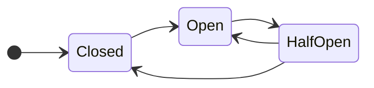
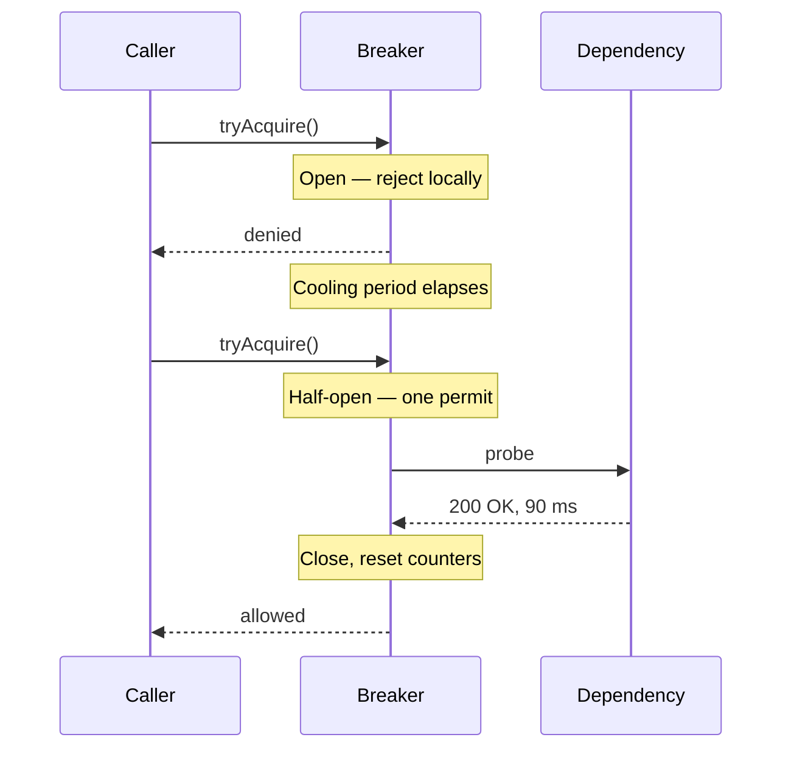

A dependency rarely fails all at once. It gets slow, returns errors for one endpoint, or accepts connections that never complete. The caller keeps doing what it was built to do — sending requests, waiting, retrying — and the failure spreads from the dependency into the caller's own worker pool.

A **circuit breaker** is a small state machine placed in front of that call. It watches outcomes. When failures cross a threshold, it stops sending ordinary traffic and fails locally instead. After a cooling period it lets a probe through. If the probe succeeds, normal traffic resumes.

The pattern was popularised by Michael Nygard in *Release It!* and described by Martin Fowler as a way to “wrap a protected function call in a circuit breaker object.”

## The mechanical metaphor

An electrical breaker trips when current exceeds a safe limit. It does not repair the wiring; it prevents the wiring from starting a fire.

A software breaker does the same thing for a call path:

- **Closed** — calls pass through. Successes reset the failure count; failures accumulate.
- **Open** — calls do not reach the dependency. The caller receives an immediate local error or a fallback.
- **Half-open** — after a wait, a limited probe is allowed through. Success closes the breaker; failure opens it again.



The important part is not the diagram. It is the decision to make the caller's failure mode **cheap and immediate** while the dependency is unhealthy.

## Why a timeout is not enough

A timeout bounds one call. It does not stop the next hundred callers from making the same doomed call.

Suppose the payment provider normally answers in 80 ms and the client timeout is 2 s. When the provider stalls, every request now occupies a worker for 2 s. At 500 concurrent requests, the service burns 1,000 worker-seconds waiting for an answer that will not arrive. Retries make it worse: one user action becomes several provider calls.

A breaker adds memory across calls. After enough evidence, it stops paying the timeout cost at all.

| Control | Scope | What it protects | What it cannot do |
| --- | --- | --- | --- |
| Timeout | One call | A single request from waiting forever | Stop the next request from trying |
| Retry | One call, repeated | A transient blip | Avoid amplifying a sustained outage |
| Circuit breaker | Many calls over time | The caller's resources and the dependency's recovery | Repair the dependency or choose a good fallback |
| Bulkhead | A resource pool | One dependency from consuming everything | Decide when the dependency is healthy |

These controls compose. A good call path usually has a timeout, a retry policy with jitter and a cap, a breaker, and a fallback — in that order.

## What counts as a failure?

A breaker is only as useful as its failure signal. “HTTP 500” is not always the right trigger.

Common signals:

- **Exception or transport error** — connection refused, DNS failure, TLS error.
- **Error response** — 5xx, or a documented retryable 4xx such as 429.
- **Latency** — a request that succeeds after 8 s can be worse than one that fails in 50 ms, because it holds a worker.
- **Application-level failure** — a 200 response with an error payload, or a health check that says “degraded”.

Do not count client mistakes (400, 401, 404) as dependency failure. A breaker that trips because users send bad input is protecting nobody.

## A worked example

Imagine an order service calling a payment provider.

```ts
const breaker = new CircuitBreaker({
  name: "payments.authorize",
  failureThreshold: 20,        // failures in the window
  windowMs: 30_000,
  openMs: 15_000,
  halfOpenMaxCalls: 1,
  isFailure: (result) =>
    result.kind === "transport_error" ||
    result.kind === "timeout" ||
    result.status >= 500,
});

async function authorize(order: Order) {
  const permit = breaker.tryAcquire();
  if (!permit.allowed) {
    return fallbackAuthorization(order);
  }

  try {
    const result = await payments.authorize(order, { timeoutMs: 800 });
    permit.record(result);
    return result;
  } catch (error) {
    permit.recordFailure(error);
    return fallbackAuthorization(order);
  }
}
```

The fallback is a product decision, not a technical afterthought. It might be:

- queue the authorization and tell the user it is pending;
- route to a secondary provider;
- decline with a clear message and a retry link;
- serve a cached, read-only view.

A breaker with no fallback still protects the caller, but the user experiences a hard failure. A breaker with a bad fallback can hide an outage until the queue is enormous.

## Half-open is the subtle state

The half-open state is where most implementations go wrong.

If the breaker opens for 15 s and then allows every waiting request through, the dependency receives a second stampede at the exact moment it is trying to recover. The probe must be **small and bounded**: one request, or a tiny fraction of traffic, with the rest still failing fast.

The probe also needs a success definition. A TCP connection that completes but returns a 503 is not a success. A request that takes 20 s is not a success.



If the dependency is a fleet, each instance keeping its own breaker sees a different sample. One instance may open while another stays closed. That is acceptable for protecting workers, but it makes the breaker a poor global health signal. If you need a fleet-wide view, aggregate outcomes somewhere else; do not assume locally opened breakers coordinate.

## Configuration is a trade-off, not a default

| Knob | Too low | Too high |
| --- | --- | --- |
| Failure threshold | Trips on normal noise; users see fallbacks during healthy operation | Keeps sending traffic into a real outage |
| Rolling window | Old failures dominate; recovery is slow to recognise | A brief burst opens the breaker for a long time |
| Open duration | Dependency gets hammered before it recovers | Users wait longer than necessary |
| Probe concurrency | A slow probe blocks useful recovery | A recovery stampede |
| Latency threshold | Healthy slow endpoints count as failures | A stalled dependency is treated as healthy |

Start from the dependency's SLOs and the caller's timeout budget. A breaker for a 50 ms cache lookup and a breaker for a 10 s report job should not share numbers.

## When not to use one

- **A single in-process call that cannot fail independently.** A pure function does not need a breaker.
- **A dependency with no meaningful alternative.** If every request must reach the provider, failing fast is still useful, but the product needs a queue or a degraded mode.
- **A call that is already idempotent and cheap enough to retry.** A breaker can still help, but measure before adding machinery.
- **As a substitute for fixing the dependency.** The breaker buys recovery time; it does not create capacity.

## Read the failure, not the diagram

In an incident, the useful questions are concrete:

- Which dependency did the breaker protect?
- What signal opened it, and at what threshold?
- What did users see while it was open?
- Did the probe actually represent recovery?
- How did the system close the loop — alert, dashboard, or a human noticing?

A breaker that opens silently and never closes is just a second outage.

<details>
<summary>Check yourself</summary>

1. Why can a circuit breaker be harmful if its failure threshold is too low?
2. What should happen to the requests that arrive while the breaker is open?
3. Why is a single half-open probe safer than letting all traffic through after the cooling period?
4. Which failures should *not* count toward opening the breaker?

</details>

## Related entries

- [Retry storm](/concepts/retry-storm) — retries turn one failing call into many.
- [Bulkhead pattern](/concepts/bulkhead-pattern) — isolate the resources a failing dependency can consume.
- [Backpressure](/concepts/backpressure) — tell the producer when the consumer cannot keep up.
- [Tail latency](/concepts/tail-latency) — why the slowest requests decide the user experience.
