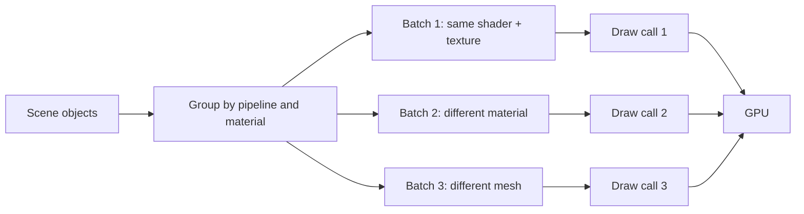

A scene with 200 triangles can run at 30 fps. A scene with two million triangles can run at 144 fps. Triangle count alone explains neither result.

The missing variable is often the **draw call**: the command that tells the GPU to render a batch of geometry with a particular pipeline state, material, and set of buffers.

Every object that cannot share that state tends to become another command. At a few hundred, the frame is fine. At tens of thousands, the CPU can spend more time preparing work than the GPU spends rendering it.

## What a draw call contains

A draw call is not just “draw this mesh”. It is a bundle of state:

- which shader program and pipeline state to use;
- which vertex and index buffers to read;
- which textures and uniform buffers are bound;
- how many instances to render;
- render targets, blend state, depth state, and viewport.

Changing any of those can force the driver to validate and submit a new command. That is why **material switches** and **state changes** are often as expensive as the draw itself.



The goal is not “zero draw calls”. It is to keep the CPU submission cost below the frame budget while preserving the culling and visual variety the scene needs.

## The three usual batching levers

### Static batching

Merge meshes that never move and share a material into one larger mesh. The result is fewer draw calls and fewer per-object transforms.

**Good for:** buildings, terrain chunks, props in a baked level, repeated environmental geometry.

**Costs:** more memory for the combined mesh, coarser culling (the whole batch is drawn if any part is visible), and a rebuild when the geometry changes.

### Dynamic batching

Combine small meshes on the CPU each frame when they share a material and meet the engine's vertex limits.

**Good for:** many small, moving objects with simple geometry.

**Costs:** per-frame CPU work to transform and copy vertices; limited by vertex count; can be slower than leaving objects separate if the batch is too large.

### GPU instancing

Send one mesh and one material once, plus a per-instance buffer of transforms and parameters. The GPU draws all instances in one call.

```glsl
// Vertex shader sketch: one mesh, many transforms
layout(location = 0) in vec3 position;
layout(location = 1) in mat4 instanceMatrix;

void main() {
  gl_Position = projection * view * instanceMatrix * vec4(position, 1.0);
}
```

**Good for:** crowds, foliage, repeated crates, particles, modular architecture, anything with the same mesh and material.

**Costs:** per-instance data upload, limited shader variation, and a loss of per-object culling unless you add an instance-level visibility pass.

| Technique | Reuses mesh | Reuses material | Moves per frame | Culling granularity |
| --- | --- | --- | --- | --- |
| Static batching | Merged | Yes | No | Coarse |
| Dynamic batching | Yes | Yes | Yes | Per source object before merge |
| GPU instancing | Yes | Yes | Yes | Coarse unless explicitly handled |
| Indirect drawing | Yes | Pipeline-dependent | Yes | GPU-driven, more complex |
| Separate objects | No | No | Yes | Fine |

## A concrete budget

Suppose a frame budget is 16.6 ms at 60 fps. On a mid-range CPU, submitting a draw call might cost tens of microseconds once driver and API overhead are included. That sounds tiny until the scene has 8,000 of them:

```text
8,000 draw calls × 20 µs = 160 ms
```

The GPU could finish the actual shading in 6 ms and still miss the frame, because the CPU cannot feed it fast enough.

The numbers vary wildly by API, driver, platform, and engine. The shape is what matters: **submission cost scales with the number of state changes**, while GPU cost scales with pixels and vertices.

## Read the frame, not the object count

A useful investigation starts with the frame debugger, not with a guess.

- **Unity:** Frame Debugger shows each draw call, its batch reason, and why batching did or did not happen.
- **Unreal:** `stat RHI`, `ProfileGPU`, and the GPU Visualizer show draw-call counts and pass costs.
- **WebGL/WebGPU:** browser developer tools and RenderDoc-style captures expose command counts and state changes.
- **Any engine:** compare draw calls, triangles, and frame time before and after a change. One number without the others is not a diagnosis.

Look for the pattern:

- thousands of draws with the same mesh and material → instancing;
- many unique small meshes sharing an atlas → static or dynamic batching;
- frequent material switches → texture atlases or material consolidation;
- a large batch that is always drawn even when most of it is off-screen → split it or use finer culling.

## The trade-offs that bite

**Batching increases memory.** A merged mesh duplicates vertices at material boundaries and may prevent sharing.

**Batching reduces culling.** If one crate in a merged pile is visible, the whole pile is submitted.

**Instancing is not free.** Updating thousands of instance transforms every frame costs bandwidth. Static instances can be uploaded once; dynamic ones cannot.

**Atlasing changes the art pipeline.** Packing textures reduces material switches but introduces bleed, resolution limits, and a shared rebuild step.

**The bottleneck moves.** Reduce draw calls far enough and the GPU becomes the limit. That is a good problem, but it is still a problem.

## The working rule

Ask three questions before optimizing:

1. **How many draw calls, and what is the frame time?** Measure both.
2. **Which objects share a pipeline and material?** Those are batching candidates.
3. **What culling or flexibility would batching remove?** Decide whether the trade is acceptable.

A draw call is a unit of **state**, not a unit of visual complexity. Once you see it that way, the optimization is usually to group work that was already conceptually the same.

<details>
<summary>Check yourself</summary>

1. Why can a scene with few triangles be CPU-bound on draw calls?
2. What is the difference between static batching and GPU instancing?
3. Why can merging meshes make culling worse?
4. Which tool would you open first to find out why an object was not batched?

</details>

## Related entries

- [Batching](/concepts/batching) — the umbrella technique.
- [Instancing](/concepts/instancing) — one mesh, many transforms.
- [Material switch](/concepts/material-switch) — the state change that breaks batching.
- [State change](/concepts/state-change) — the broader cost behind draw-call overhead.
