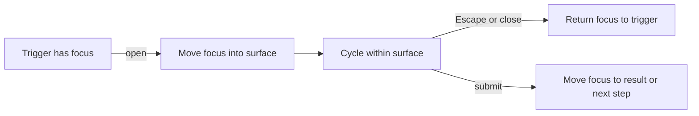

For a mouse user, an interface is a set of targets. For a keyboard user, it is a **sequence**. Focus is the cursor that moves through that sequence, and every time an interface opens, closes, or replaces a region, the sequence changes.

Focus management is the work of making that sequence intentional:

- move focus into a surface when it opens;
- keep focus inside it while the surface is modal;
- return focus to the trigger when it closes;
- move focus to new content after navigation;
- never remove the visible indicator that tells someone where they are.

None of this is decorative. WCAG 2.4.3 requires a focus order that preserves meaning and operability. WCAG 2.4.7 requires a visible focus indicator.

## The three moves

Most focus bugs are one of three failures.

### 1. Focus is not moved

A dialog opens, but focus stays on the button behind it. The keyboard user presses Tab and walks through the page underneath the overlay. The dialog is visible but unreachable.

### 2. Focus escapes

Focus moves into the dialog, then Tabs out of it into the page behind. The overlay says “modal”; the keyboard says otherwise.

### 3. Focus is not restored

The dialog closes and focus falls to the document body. The next Tab starts from the top of the page, not from the control that opened the dialog. The user has lost their place.



## Start with the native dialog

If the surface is a modal dialog, the browser already provides a strong primitive: the `<dialog>` element with `showModal()`.

```html
<dialog id="settings">
  <h2>Settings</h2>
  <label>
    Display name
    <input name="displayName" />
  </label>
  <button data-close>Cancel</button>
  <button type="submit">Save</button>
</dialog>

<button id="open-settings">Open settings</button>

<script>
  const dialog = document.getElementById("settings");
  const trigger = document.getElementById("open-settings");

  trigger.addEventListener("click", () => {
    dialog.showModal();
  });

  dialog.addEventListener("close", () => {
    trigger.focus();
  });
</script>
```

`showModal()` does several useful things:

- renders the dialog in the top layer, above other content;
- makes the rest of the document inert for interaction;
- gives the dialog an implicit modal semantic;
- moves focus into the dialog according to the browser's rules.

The exact containment behaviour has changed across browsers, which is why some authors still add a fallback focus loop. The CSS-Tricks article linked above argues that a modern `<dialog>` already contains focus and that a manual trap can fight the platform. Test your target browsers rather than assuming either position.

What the platform does **not** do for you is choose the best initial focus or restore focus after close. Those remain your responsibility.

## Custom dialogs need an explicit contract

If you build a custom overlay with `div` elements, you are responsible for the behaviour the native dialog provides.

A practical contract:

1. On open, store `document.activeElement`.
2. Move focus to the first meaningful control, or to the dialog container with `tabindex="-1"`.
3. While open, mark the rest of the page inert, or implement a focus loop.
4. Close on Escape and on an explicit close control.
5. On close, restore focus to the stored trigger.
6. Keep the focus indicator visible throughout.

Using `inert` is often cleaner than a keydown-based focus trap because it removes the background from both the tab order and the accessibility tree:

```tsx
useEffect(() => {
  if (!open) return;

  const previous = document.activeElement as HTMLElement | null;
  const dialog = dialogRef.current;
  const background = document.getElementById("page-shell");

  background?.setAttribute("inert", "");
  dialog?.querySelector<HTMLElement>("[data-autofocus]")?.focus();

  return () => {
    background?.removeAttribute("inert");
    previous?.focus();
  };
}, [open]);
```

A manual trap is still necessary in environments without `inert`, or when the overlay is not a true modal.

## Choose the right initial focus

“Focus the first focusable element” is a common default, not a rule.

| Surface | Usually focus | Why |
| --- | --- | --- |
| Confirmation dialog | Least destructive action, or the heading | Prevents accidental confirmation |
| Form dialog | First field | Gets the task started |
| Destructive dialog | Cancel button | Makes Enter safe |
| Command palette | The search input | Typing is the primary action |
| Menu | First item, or the item matching the current selection | Keeps arrow-key navigation immediate |
| Route change | Main heading or main region | Announces the new page and resets the sequence |
| Toast | Usually no focus move | It is status, not a task |

The APG dialog pattern notes that initial focus should generally go to the first focusable element, but the most appropriate element depends on the content. For a destructive dialog, “first focusable” may be the delete button — a poor default.

## Focus visible is part of focus management

Moving focus is useless if the user cannot see where it went.

```css
:focus-visible {
  outline: 2px solid var(--focus);
  outline-offset: 2px;
}
```

Avoid `outline: none` without a replacement. If the design needs a custom ring, use `:focus-visible` so pointer users do not see a ring on every click while keyboard users still get one.

## Menus, toolbars, and roving tabindex

Not every composite widget should put every child in the Tab sequence. A toolbar with twelve buttons would force a keyboard user to Tab through all twelve to leave it.

The roving tabindex pattern gives the group **one** tab stop and moves focus with arrow keys:

- one item has `tabindex="0"`;
- the others have `tabindex="-1"`;
- ArrowRight and ArrowLeft move focus and swap the tabindex values;
- Tab leaves the group entirely.

This is the same idea behind menus, tab lists, and radio groups. The group is one stop in the page sequence; the arrow keys move inside it.

## Route changes in a single-page app

A full page load resets focus to the document. A client-side route change does not. Without intervention, the user stays focused on the link they activated while the content underneath changes.

After navigation:

1. Move focus to the main heading or main region.
2. Give that element `tabindex="-1"` if it is not naturally focusable.
3. Announce the new page title if the route change is not otherwise obvious.

```tsx
useEffect(() => {
  const heading = document.querySelector<HTMLElement>("main h1");
  if (!heading) return;
  heading.setAttribute("tabindex", "-1");
  heading.focus({ preventScroll: true });
  heading.scrollIntoView({ block: "start" });
}, [pathname]);
```

Do this after the new content exists, not before. Focusing an element that is about to unmount produces the same broken state you were trying to fix.

## Test it without a mouse

The only reliable test is to complete the task using the keyboard alone:

- Tab to the trigger.
- Activate it with Enter or Space.
- Confirm focus enters the surface.
- Tab through the surface; confirm focus does not disappear behind it.
- Press Escape; confirm the surface closes.
- Confirm focus returns to the trigger.
- Repeat after a client-side route change.
- Repeat with a screen reader, because the accessibility tree may disagree with the visual tree.

Automated tools can catch missing names and some ARIA misuse. They cannot tell you whether the sequence makes sense.

<details>
<summary>Check yourself</summary>

1. Why is “focus the first focusable element” a risky default for a destructive dialog?
2. What does `inert` do that a keydown-based focus trap does not?
3. Why does a client-side route change need explicit focus handling?
4. When should a toast receive focus, and when should it not?

</details>

## Related entries

- [Focus state](/concepts/focus) — the visual indicator that makes focus legible.
- [Focus restoration](/concepts/focus-restoration) — returning to the trigger after a surface closes.
- [Focus trap](/concepts/focus-trap) — the containment mechanism, and when the platform already provides it.
- [Keyboard navigation](/concepts/keyboard-navigation) — the broader sequence focus lives inside.
