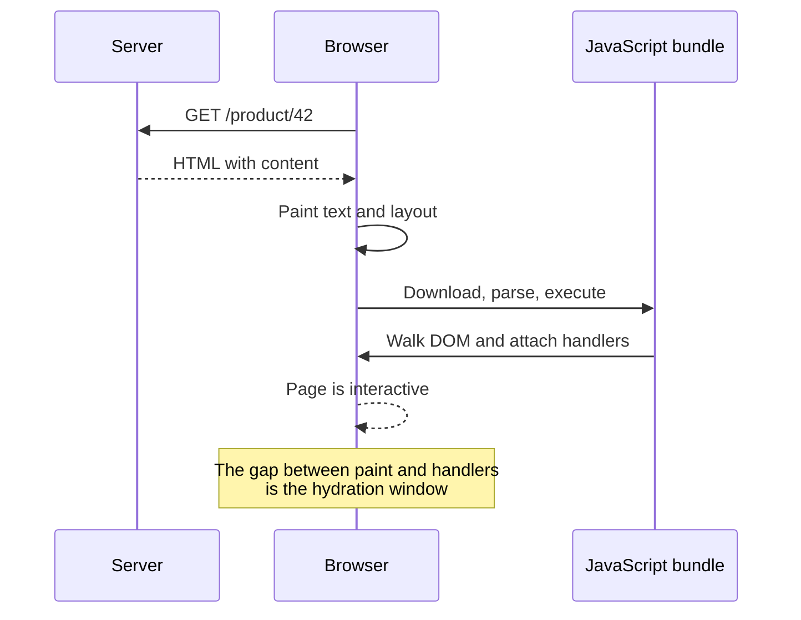

import HydrationLab from "../../components/labs/HydrationLab";

A server-rendered page can arrive in a few hundred milliseconds. It can paint text, images, and layout immediately. Then, for a moment, nothing responds.

Click a button and nothing happens. Type in a search field and the characters appear but no filtering starts. The page **looks** finished while its event handlers are still in transit.

That gap is hydration.

## What hydration actually does

In a server-rendered app, the server sends HTML that already describes the UI. The browser can paint it before any application JavaScript runs.

Hydration is the client-side pass that:

1. loads the component code,
2. walks the existing DOM,
3. attaches event listeners and internal state,
4. takes ownership of the page so future renders update the existing nodes instead of replacing them.

React calls this process “attaching to existing HTML that was already rendered by React in a server environment.” The modern entry point is `hydrateRoot`:

```tsx
import { hydrateRoot } from "react-dom/client";
import App from "./App";

hydrateRoot(document.getElementById("root"), <App />);
```

The server produced the markup. The client does not re-create it; it connects the component tree to the markup that is already there.



The page is **visible** before it is **interactive**. Core Web Vitals captures one side of this: First Contentful Paint measures when content appears; Interaction to Next Paint measures how long interactions take once they happen. Neither directly names the hydration gap, which is why a page can look fast and still feel dead.

<HydrationLab client:visible />

Try the save button before the island finishes hydration. The click lands on a real button with no handler attached yet; that is the gap in miniature.

## What hydration costs

Hydration is not free just because the HTML was reused.

| Cost | Why it exists |
| --- | --- |
| Download | The component code and its dependencies must reach the browser |
| Parse and compile | JavaScript must be parsed before it can run |
| Execution | The runtime walks the component tree and reconciles it with the DOM |
| Duplicate work | Components often recompute values the server already computed |
| Blocking | Long hydration tasks compete with input, animation, and paint |
| Mismatch handling | If the client tree disagrees with the server HTML, React may discard and re-render |

The last cost is the most visible. A hydration mismatch happens when the server and client produce different trees:

- a timestamp or `Math.random()` in render;
- `window` checks that return different values;
- locale-dependent formatting;
- invalid HTML nesting that the parser repairs differently;
- third-party scripts mutating the DOM before hydration.

React will warn in development and can fall back to client rendering. The user experiences a flash or a replaced subtree.

## The spectrum of strategies

Hydration is one point on a larger design spectrum.

| Strategy | What the browser receives | When interactivity starts | Trade-off |
| --- | --- | --- | --- |
| Client-side rendering | Almost empty shell | After JS downloads and renders | Simple mental model, slow first paint |
| SSR + full hydration | Complete HTML | After the whole app hydrates | Fast paint, large hydration cost |
| Streaming SSR | HTML in chunks | As each boundary hydrates | More complex server and error handling |
| Islands / partial hydration | Complete HTML | Per interactive island | Great for content sites, less natural for app shells |
| Resumability | Complete HTML plus serialized state | On interaction, without replaying the app | Newer model, different debugging and ecosystem constraints |

### Islands

An islands architecture renders the page as static HTML and hydrates only the interactive regions. Astro calls these “islands” and lets you choose when each one loads:

```astro
---
import Search from "../components/Search.astro";
import Cart from "../components/Cart.tsx";
---

<Search />
<Cart client:visible />
```

`client:visible` means the cart's JavaScript is not fetched or executed until the island approaches the viewport. The rest of the page remains plain HTML with no hydration cost.

The catch is composition. Two islands do not share React context by default, and state that spans the whole page pushes you back toward a single hydrated root.

### Progressive and selective hydration

Streaming SSR lets the server send HTML in pieces. React can hydrate boundaries independently; an interaction inside a not-yet-hydrated boundary can be replayed after that boundary is ready.

This improves perceived responsiveness, but it does not make hydration free. It changes **when** the cost is paid and lets urgent regions jump the queue.

### Resumability

Qwik's model skips the “replay the app to rebuild state” step. Instead, the server serializes enough state and event information for the client to resume at the point of interaction. The framework's own documentation frames this as resumability rather than hydration.

Whether it fits depends on the application. A content site with a few controls rarely needs it. A large, stateful application benefits from understanding the model even if it does not adopt it.

## A practical checklist

When a page “looks ready but isn't”:

1. **Measure the gap.** Record a trace, find the first paint, then find the hydration task. The distance between them is the problem.
2. **Identify what is hydrating.** Is the whole app a client root, or only a few islands?
3. **Move hydration later.** `client:idle` or `client:visible` for below-the-fold widgets; keep above-the-fold controls eager.
4. **Split the bundle.** A smaller component tree hydrates sooner, especially on mid-range phones.
5. **Avoid work during render.** Read browser-only values in effects, not in the server-rendered path.
6. **Fix mismatches at the source.** Do not suppress the warning; make server and client agree.
7. **Test with JavaScript throttled.** A fast laptop hides a hydration gap that a phone will expose.

## The mental model

Think of the HTML as a **photograph** and hydration as **wiring the photograph to the controls**.

- A photograph is useful immediately.
- Wiring takes time.
- The more of the page you wire, the longer the gap.
- The best fix is usually to wire less, not to wire faster.

That framing explains why islands, selective hydration, and resumability all exist. They are different answers to the same question: which parts of this page actually need to be alive?

<details>
<summary>Check yourself</summary>

1. What is the difference between First Contentful Paint and the end of hydration?
2. Why can a page with excellent LCP still feel unresponsive?
3. What causes a hydration mismatch, and why is suppressing the warning a bad fix?
4. When would you choose an island over a single hydrated root?

</details>

## Related entries

- [Island architecture](/concepts/island-architecture) — the composition model that makes partial hydration practical.
- [Long task](/concepts/long-task) — hydration often arrives as one.
- [Main-thread blocking](/concepts/main-thread-blocking) — what the gap competes with.
- [View transition](/concepts/view-transition) — keeping continuity when the hydrated page changes.
- [Skeleton](/concepts/skeleton) — the fallback a boundary paints while the island is still a comment pair.
