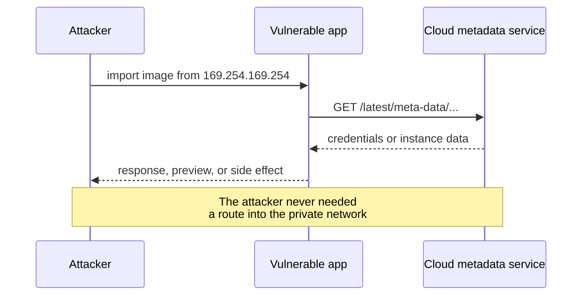

An image importer accepts a URL. A webhook tester sends a request to a callback. A PDF service renders a page. A link preview fetches metadata. Each feature is useful because the **server** makes an outbound request on the user's behalf.

Server-side request forgery is what happens when the user chooses the destination.

The attacker does not need to reach the internal network from their laptop. They ask your server — which already sits inside the network, often with credentials and a permissive egress path — to make the request for them.

## The canonical example

A product image field accepts a URL:

```text
https://shop.example/import?image=https://cdn.example/cat.jpg
```

The server fetches the URL and stores the bytes. An attacker submits:

```text
https://shop.example/import?image=http://169.254.169.254/latest/meta-data/iam/security-credentials/
```

If the server is running in a cloud instance and that metadata service is reachable, the response may contain temporary credentials. The attacker's request never touched the metadata endpoint directly; the vulnerable server did.



The same primitive appears in:

- webhook and callback testers;
- URL-to-PDF and URL-to-screenshot services;
- RSS and feed readers;
- image proxies and transformers;
- link previews and unfurlers;
- XML parsers that resolve external entities;
- headless browsers loading attacker-supplied pages;
- integrations that import from “any URL”.

## Why it is dangerous even when the response is hidden

SSRF is often classified by what the attacker can see:

| Type | What the attacker gets | Example |
| --- | --- | --- |
| Basic | The full response body | Image proxy returns internal admin page |
| Blind | No body, but timing or side effects | Webhook tester confirms port 22 is open |
| Semi-blind | Errors or metadata leak | Different error for open vs closed ports |

A blind SSRF can still be serious. The attacker can scan the internal network, trigger state-changing requests, reach admin endpoints that trust the server's IP, or use timing to map services. The absence of a response does not mean the absence of impact.

## The bypasses that defeat string checks

A blocklist of “localhost” and “127.0.0.1” is not a defence. Attackers have many ways to express the same destination:

- alternate IP encodings: decimal, octal, hexadecimal;
- IPv6 loopback and IPv4-mapped IPv6 addresses;
- DNS names that resolve to private addresses;
- DNS rebinding: the first resolution is public, the fetch resolution is private;
- URLs with userinfo or encoded separators that confuse parsers;
- redirects from an allowed host to a forbidden one;
- non-HTTP schemes such as `file:`, `gopher:`, and `dict:` where the client supports them;
- cloud metadata hostnames and link-local addresses.

The OWASP Top 10 entry describes SSRF as occurring when an application fetches a remote resource without validating the user-supplied URL. The word **validating** is doing a lot of work there.

## Defences that survive contact with attackers

### 1. Prefer an allowlist

If the feature only needs to fetch from known partners, list the hosts and paths it may use. This is the strongest control because it removes the attacker's choice of destination.

```ts
const ALLOWED_HOSTS = new Set(["cdn.partner.example", "images.partner.example"]);

function assertAllowed(url: URL) {
  if (url.protocol !== "https:") throw new Error("https only");
  if (!ALLOWED_HOSTS.has(url.hostname)) throw new Error("host not allowed");
  if (url.port && url.port !== "443") throw new Error("port not allowed");
}
```

An allowlist is also easier to review than a blocklist of everything that might be internal.

### 2. Resolve, check, and pin

When arbitrary public URLs are part of the product, validate the **resolved address**, not just the hostname:

- reject loopback, private, link-local, multicast, unspecified, and reserved ranges;
- cover IPv6, not just IPv4;
- re-check every redirect hop;
- pin the resolved address for the connection, or re-resolve and compare immediately before connecting.

The last point matters because DNS can change between validation and fetch. A check-then-fetch sequence is a time-of-check/time-of-use gap.

### 3. Disable or constrain redirects

A redirect is a second request you did not validate. Either disable redirects entirely or follow them manually, revalidating each hop.

### 4. Restrict schemes and methods

If the feature fetches images over HTTPS, allow only `https:`. Do not let a URL parser hand `file:` or `gopher:` to a client that supports it. Restrict methods to what the feature needs; a preview fetcher rarely needs POST.

### 5. Put the network in the way

Application checks can be bypassed by parser bugs and rebinding. Network controls are the backstop:

- egress allowlists that permit only required third-party hosts;
- no route from the application subnet to cloud metadata;
- metadata services hardened to require a session token or a custom header;
- separate service accounts and least-privilege roles so a reachable metadata endpoint yields as little as possible.

AWS's IMDSv2 guidance is a concrete example: requiring a token makes a simple GET-based SSRF less directly useful. It is not a complete SSRF defence, which is why the “defense in depth” article exists.

### 6. Bound the response

Even a legitimate fetch can be abused:

- cap response size;
- cap redirects;
- set connect and read timeouts;
- do not return the raw body to the user unless the feature requires it;
- strip sensitive headers and never forward the application's credentials to the target.

## What good code looks like

The shape matters more than the exact library:

```ts
async function fetchPublicImage(rawUrl: string) {
  const url = new URL(rawUrl);
  if (url.protocol !== "https:") throw new Error("https only");

  const address = await resolveAndValidate(url.hostname);
  if (!address.isPublic) throw new Error("destination not allowed");

  const response = await fetch(url, {
    redirect: "manual",
    signal: AbortSignal.timeout(5_000),
    headers: { "user-agent": "ohaio-image-fetcher/1.0" },
  });

  if (response.status >= 300 && response.status < 400) {
    throw new Error("redirects are not followed");
  }
  if (!response.ok) throw new Error(`upstream ${response.status}`);
  if (Number(response.headers.get("content-length") ?? 0) > 5_000_000) {
    throw new Error("response too large");
  }

  return response.body;
}
```

This is not a complete SSRF solution. It shows the shape: strict scheme, resolved-address validation, no automatic redirects, timeouts, size limits, and no credential forwarding.

## Detection and response

SSRF is easier to contain when you can see it:

- egress logs showing requests to loopback, link-local, or private ranges;
- DNS queries for metadata hostnames or unusual internal names;
- sudden requests from an application service to admin ports;
- metadata service access from workloads that should not need it;
- outbound requests with attacker-controlled hostnames from URL-import features.

If you suspect an SSRF incident, rotate any credentials the workload could reach, review metadata access, and check whether the vulnerable endpoint returned response bodies. The application logs may show only a successful fetch; the network logs show where it went.

## Practise in a lab

PortSwigger's Web Security Academy provides deliberately vulnerable labs for basic, blind, and filter-bypass SSRF. Use those rather than testing against systems you do not own. The goal of the exercise is to build the defender's instinct: every feature that lets a user choose a URL is a potential outbound request from a privileged position.

<details>
<summary>Check yourself</summary>

1. Why is SSRF dangerous even when the attacker cannot see the response body?
2. Why does blocking “localhost” and “127.0.0.1” fail as a defence?
3. What is DNS rebinding, and why does it require care around the fetch itself?
4. Which network-level controls reduce SSRF impact when application validation fails?

</details>

## Related entries

- [SQL injection](/concepts/sql-injection) — another case where user input becomes a command in a different language.
- [CSRF](/concepts/csrf) — abusing the browser's authority; SSRF abuses the server's.
- [PCAP analysis](/concepts/pcap-analysis) — the network evidence that often reveals an SSRF path.
- [Hermetic build](/concepts/hermetic-build) — another argument for controlling what a build or service may fetch.
