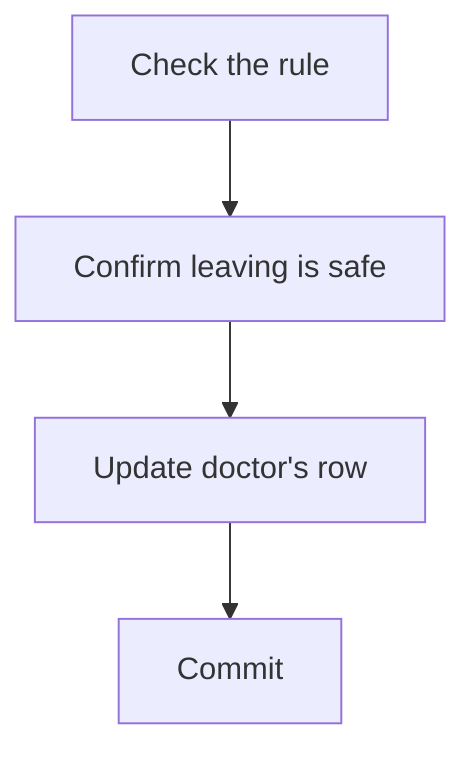
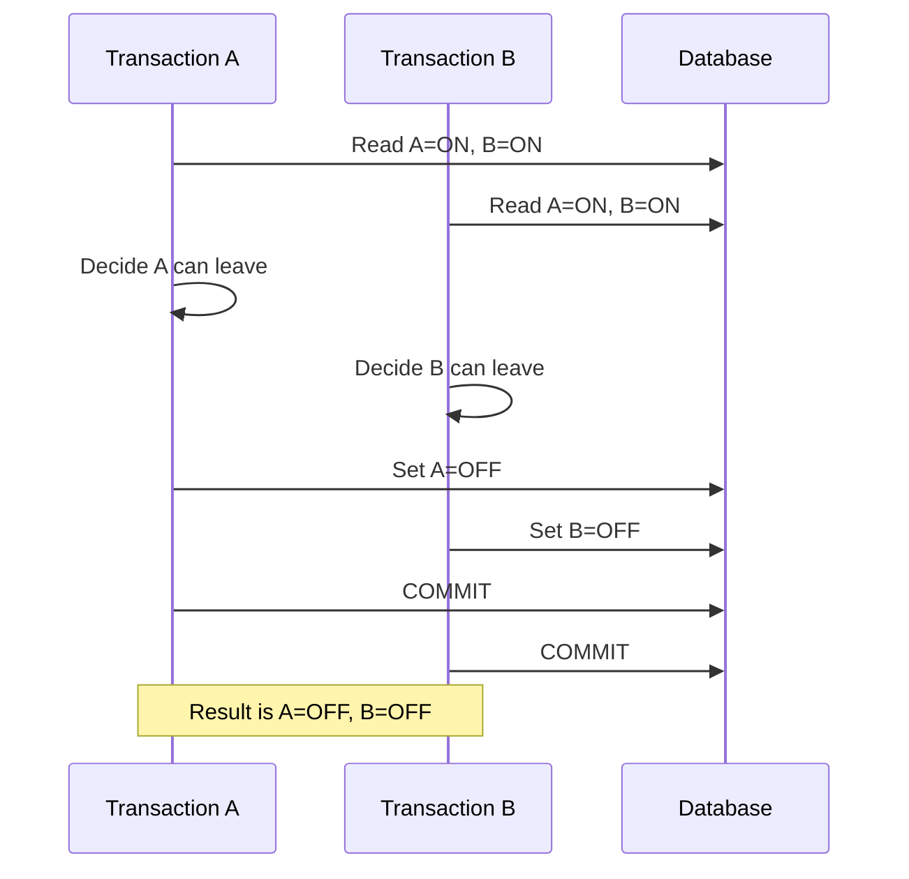
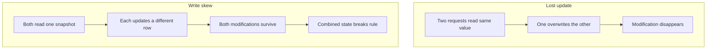
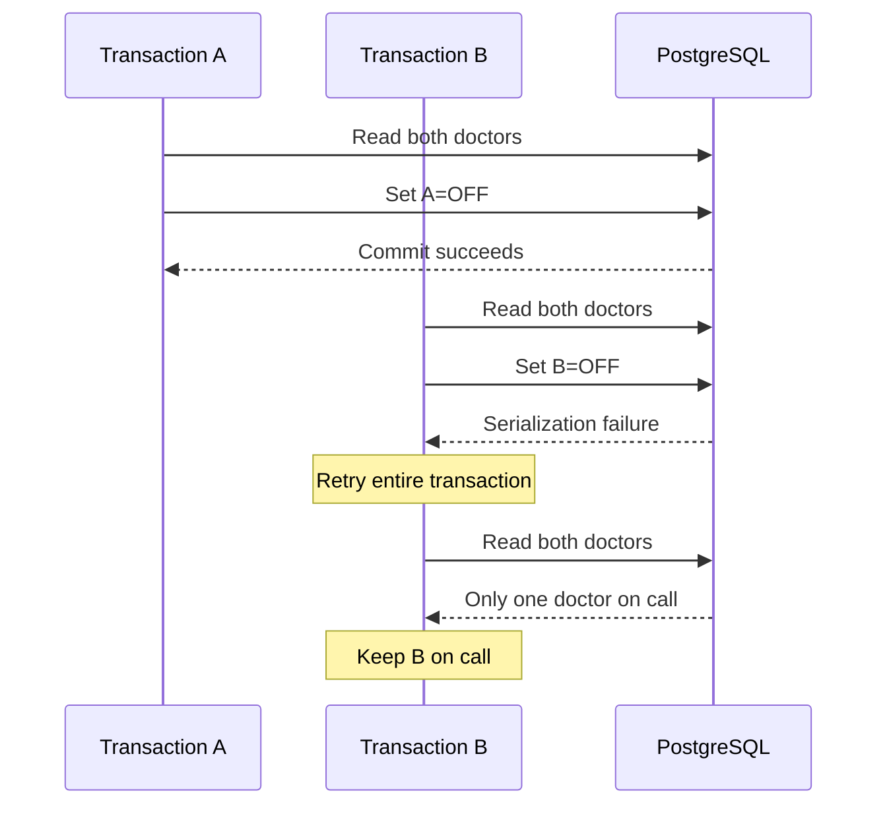
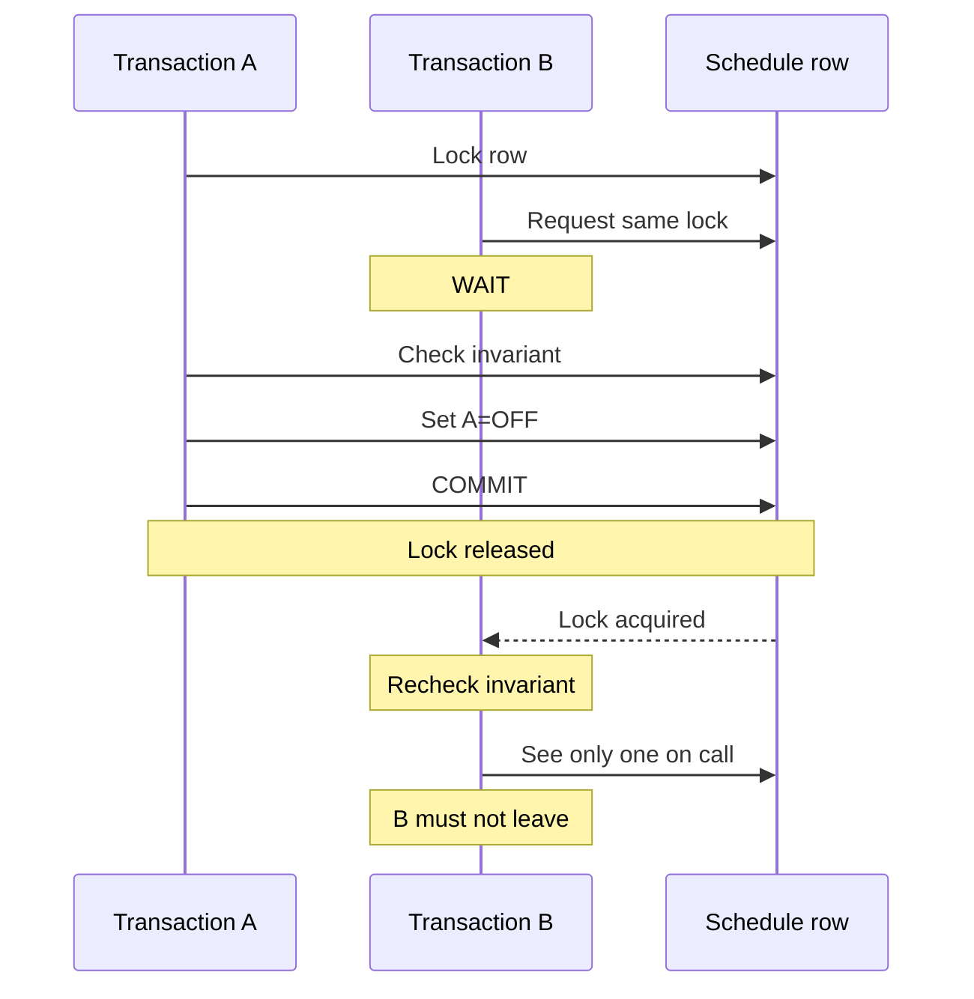
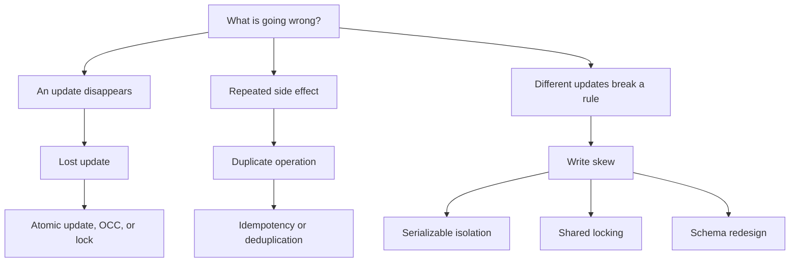

## Write Skew: When Every Transaction Is Correct, but the Database Becomes Incorrect

**Today's concept:** Write skew and transaction isolation.

Yesterday, we learned how concurrent requests can overwrite one another. Today, we'll explore a subtler failure: **two transactions modify different rows, both commit successfully, and together violate a business rule.**

This is particularly important when building booking systems, financial applications, scheduling software, and other systems with cross-record invariants.

---

## 1. What is write skew?

Imagine a hospital has two doctors on call:

| Doctor | On call? |
|---|---|
| Doctor A | Yes |
| Doctor B | Yes |

The hospital has a rule:

> At least one doctor must remain on call at all times.

Now suppose both doctors independently request leave.

Doctor A's transaction checks whether Doctor B is on call. Doctor B's transaction checks whether Doctor A is on call.

Both see that the other doctor is available.

Both conclude that their own leave is safe.

Both update different rows and commit.

The result:

| Doctor | On call? |
|---|---|
| Doctor A | No |
| Doctor B | No |

**The database has accepted a state that violates the business rule, even though both transactions individually appeared valid.**

This is called **write skew**.

It is a classic concurrency anomaly associated with snapshot isolation. PostgreSQL's official documentation explains how `REPEATABLE READ` can permit serialization anomalies, while `SERIALIZABLE` provides a stronger guarantee. 

---

## 2. Try it yourself

I've built a small interactive experiment.

You can switch between three strategies:

- **Repeatable Read:** See how both transactions can commit and break the rule.
- **Serializable:** See how the database prevents the invalid combined outcome.
- **Explicit guard lock:** See how transactions can coordinate through a shared resource.

Start with Repeatable Read. Watch both doctors go off call.

Then switch to Serializable and run the same scenario again.

The goal is to understand *why* the results differ, not merely memorize which setting is safer.

---

## 3. What problem exists without write-skew protection?

Consider the logic implemented by each transaction.

Transaction A:

```sql
BEGIN;

SELECT COUNT(*)
FROM doctors
WHERE on_call = TRUE;

UPDATE doctors
SET on_call = FALSE
WHERE id = 'A';

COMMIT;
```

Transaction B performs equivalent logic for Doctor B.

For simplicity, imagine both transactions check that at least two doctors are currently on call before allowing one to leave.

The application logic seems reasonable:



But this assumes the state checked by the transaction will remain suitable when the transaction commits.

Under concurrent execution, that assumption can be false.

### The dangerous interleaving



Neither transaction necessarily overwrote the other's row.

Both simply made decisions using information that was no longer sufficient to guarantee the combined result.

---

## 4. Why does this happen from first principles?

The key is the difference between **row-level correctness** and **invariant-level correctness**.

A row-level rule might be:

```text
Doctor A's on_call field must be TRUE or FALSE.
```

Both transactions satisfy that rule.

But the actual business invariant is:

```text
COUNT(doctors where on_call = TRUE) >= 1
```

This rule spans multiple rows.

The database must preserve the relationship between those rows, not just ensure that each individual update is valid.

Think of the distinction this way:

| Level | Observation | Result |
|---|---|---|
| Row level | Doctor A is OFF | ✓ Valid |
| Row level | Doctor B is OFF | ✓ Valid |
| Global invariant | 0 doctors on call | ✗ Needs at least 1 |

The subtlety is that **two locally valid changes can produce one globally invalid result**.

This is why a database can execute valid SQL statements and still permit an application-level correctness failure under an insufficient isolation strategy.

---

## 5. How is write skew different from a lost update?

This distinction is worth memorizing.

| Property | Lost update | Write skew |
|---|---|---|
| Main problem | One change overwrites another | Combined changes violate a rule |
| Typical writes | Same row | Different rows |
| Typical detection | Conflicting update or version check | Requires reasoning about cross-row dependencies |
| Possible solution | Atomic update, lock, OCC | Serializable isolation, coordinated locking, suitable schema constraints |
| Core failure | Lost modification | Invalid combined state |

### The causal connection



An important implication follows:

**Preventing lost updates is not enough to guarantee transaction correctness.**

You must also consider the relationships between the records your transactions read and modify.

---

## How do we prevent write skew?
There are several approaches. The right one depends on the invariant and the required concurrency.

## Strategy A: Serializable isolation

A serializable transaction behaves as though committed transactions ran one at a time in some valid order.

For PostgreSQL:

```sql
BEGIN TRANSACTION ISOLATION LEVEL SERIALIZABLE;

-- Check the business invariant.
-- Update the doctor's on-call status.

COMMIT;
```

PostgreSQL monitors dependencies between concurrent serializable transactions. If their combined execution cannot be explained by a valid serial order, it can abort a transaction with a serialization failure. 

For our example:



The result preserves the invariant.

### Important: Handle serialization failures

Serializable isolation does not mean every transaction will succeed on its first attempt.

Your application must recognize serialization failures and retry the **entire transaction**, starting with fresh reads and repeating the business logic.

Do not blindly retry just the final SQL statement. The original decision may have depended on stale information.

Also, any external side effects performed before a transaction's successful commit require separate care. A database retry must not accidentally repeat a payment, send a duplicate email, or perform another irreversible action.

---

## Strategy B: Explicit locking

Another approach is to make both transactions coordinate through a shared resource.

For example, introduce a row representing the on-call schedule:

```text
on_call_schedule
----------------
schedule_id
```

Both transactions acquire a lock on the same schedule row before checking and modifying the doctors.

Conceptually:



The important detail is that the lock must coordinate **all transactions that can violate the invariant**.

Locking Doctor A in one transaction and Doctor B in another would not necessarily solve the problem, because those are different rows.

A shared guard row gives both transactions something common to coordinate around.

PostgreSQL supports explicit row-level locking through clauses such as `SELECT ... FOR UPDATE`. 

### Trade-off

Explicit locking can make application behavior easier to reason about, but it creates contention. Transactions competing for the same lock must wait.

You must also ensure that every relevant code path follows the locking protocol.

---

## Strategy C: Redesign the data model

Sometimes the best solution is to represent the invariant in a way that is easier to enforce.

For example, a booking system might maintain a single inventory record:

```text
room_inventory
--------------
room_id
available_slots
```

A conditional update can enforce a simple capacity invariant directly:

```sql
UPDATE room_inventory
SET available_slots = available_slots - 1
WHERE room_id = 42
  AND available_slots > 0;
```

Then inspect the number of affected rows.

This is often simpler than reading several records, calculating availability in application code, and later updating a different set of records.

However, this approach works only if the inventory record accurately represents the business rule and every booking path updates it consistently.

A schema constraint is even better when the invariant can be expressed directly as a database constraint. Cross-row aggregate rules often require a different strategy, such as a serialized transaction, a shared coordination record, or a carefully designed schema.

---

## The production failure
Imagine an online appointment platform.

Its rule is:

> Every shift must have at least one qualified engineer on call.

Initially:

| Shift | Engineer A | Engineer B |
|---|---|---|
| 09:00 | ON CALL | ON CALL |

At 08:59, both engineers request leave.

Two application servers process their requests concurrently.

Each server queries the database and sees two engineers on call. Each decides that one engineer can safely leave.

The transactions update different rows and both commit.

At 09:00:

| Shift | Engineer A | Engineer B |
|---|---|---|
| 09:00 | OFF CALL | OFF CALL |

No engineer is available.

The application may have passed every unit test. Each transaction works correctly when tested in isolation. The failure only appears when the requests overlap.

### What would you investigate?

1. The invariant the system is supposed to preserve.
2. The transaction isolation level used by the database.
3. The exact reads and writes performed by both transactions.
4. Whether concurrent transactions can update different rows while relying on the same cross-row condition.
5. Whether the solution uses serializable isolation, shared locking, or a schema design that enforces the invariant.

This is the sort of issue that can remain hidden until production traffic introduces the right timing.

---

## The mental model to retain
The most important distinction is:

> **A transaction can be individually valid without being safe to commit alongside another transaction.**

Use this decision map:



These three failure modes are related, but they are not interchangeable. A robust backend must choose the mechanism that matches the actual failure.

---

## Active recall — today's questions

Answer these without looking back at the lesson.

1. Why can two transactions that update different rows both commit and still violate a business invariant?

2. What is the key difference between a lost update and write skew?

3. Why might PostgreSQL's `REPEATABLE READ` isolation level be insufficient to preserve a cross-row invariant?

4. Under `SERIALIZABLE`, why must an application be prepared to retry the entire transaction?

5. In the on-call doctor example, why might locking one shared schedule row work better than locking each doctor's row independently?

---
